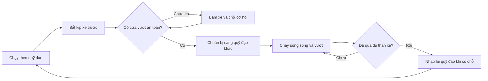

# Thiết kế lại trải nghiệm đua xe — v0.3 (đã triển khai thử nghiệm)

> **Cập nhật nhịp đua 09/11/2026:** [10 — Đua liên tục theo thời gian](10_Continuous_Race_Loop.md) thay luật đủ 3 vòng/cán vạch để kết thúc và luồng chờ người chơi bắt đầu/đóng kết quả. Thiết kế mới giữ cơ chế xe không cản nhau ở §10 của tài liệu này, nhưng xếp hạng theo tổng tiến trình khi hết thời lượng cấu hình. Chưa triển khai; số đo bên dưới vẫn thuộc mô hình kết thúc theo số vòng.

> **Cập nhật nhịp 10/11/2026 (nhanh hơn, nhiều diễn biến hơn):** `traffic.speed_scale` = 1,5 nhân đều tốc độ, gia tốc, phanh, tốc độ ngang của TrafficSim (RaceSim v1.0 không đổi); lượt đua 60 → 40 giây (`race_loop.race_duration_seconds`). Thêm **hút gió** `draft_bonus` = 3% khi có xe phía trước trong `draft_len` = 3 thân xe — nới nguyên tắc §10 mục 1 ("tốc độ chỉ do chỉ số, form, lỗi"): xe khác vẫn không làm xe nào chậm lại, nhưng xe bám đuôi được cộng tốc độ. Đo `tests/lab/pace_lab.gd` (200 seed, Δ = 0): người chơi đổi hạng 5,4 → 11,0 lần/lượt; hạng TB khi Δ +10 giữ 1,66 → 1,69 (chỉ số vẫn quyết định); chồng hình 4,3% thời gian xe. Đặt `draft_bonus` = 0 để quay về mô hình cũ.

> **Bot kịch bản (10/11/2026):** `data/sim.json["ai_cars"]` (toàn cục, 7 bot) thay cho cặp `ai_offsets`/`ai_names` khi chạy `TrafficSim`; `RaceSim` v1.0 vẫn dùng cặp cũ. Mỗi bot: `name` (bắt buộc, duy nhất); `offset` (lệch chung cho mọi chỉ số, mặc định 0); `stats` {S,H,B,A,P,T,C} lệch so với chuẩn giải, ghi đè `offset` cho từng chỉ số; `trait` (id đặc tính tay đua); `form` cố định trong [0,8; 1,2] (ghi đè form ngẫu nhiên, đã gồm giãn đoàn); `grid_slot` 0–7 cố định (duy nhất). Ví dụ: `{"name": "Rồng", "stats": {"S": 12, "H": -9}, "trait": "straight_line", "form": 1.02, "grid_slot": 5}` = mạnh đoạn thẳng, yếu cua, luôn xuất phát ô 6. Dữ liệu sai bị `GameData.validate()` báo rõ bot và trường. Giá trị mặc định tương đương hệt cách cũ nên golden không đổi. Chưa có kịch bản theo chặng/giải.

> **Cập nhật trình bày 10/11/2026 (theo game mẫu: chấm tròn, đường lớn):** `RaceView` vẽ mỗi xe là một chấm tròn màu (có thể chồng nhau; xe người chơi to, viền trắng, có tam giác chỉ), HUD lớn trên đầu (hạng P x/8, đồng hồ, vòng, khoảng cách xe trước) và thanh tiến trình trải thẳng một vòng. Prototype đua trên **Circuit B** (`track_circuit_b`, `lap_length` riêng 924, 296 × 238 đơn vị, 17 sector, 8 lần đổi chiều cua) thay vì oval 400; lượt 40 giây xe đầu chạy ~1,1 vòng. Circuit A giữ lại cho test/golden. Mỗi track có thể khai báo `lap_length` riêng (`GameData.lap_length_of`). Đo (200 seed, Δ = 0): người chơi đổi hạng ~16 lần/lượt, hạng TB khi Δ +10 là 1,41, ~1 lỗi/xe/lượt. Lane tránh nhau trong sim giữ nguyên (chỉ để chấm không dồn một chỗ), vì chấm chồng nhau chấp nhận được. Đã thử dao động tốc độ hình sin (biên độ 1–3%): không thêm diễn biến, đã bỏ.

Ngày: 09/11/2026. **Trạng thái: đã triển khai thử nghiệm** trong `TrafficSim` + `TrackLayout` + track `Circuit A`; prototype (`GameState`, `RaceView`) đã chạy bằng mô phỏng mới. `RaceSim` v1.0 vẫn còn trong mã làm chuẩn tham chiếu cho golden và lab. Công thức cân bằng **chưa chốt**: kết quả đo sơ bộ ở §10.

**v0.3 (sau khi triển khai):** §3 cập nhật Circuit A theo hình học khép kín thật; §4.2 mô tả hành vi đã cài; §10 ghi kết quả bước 0 và các điều phát hiện khi chạy. **v0.2 (sau rà soát với mã nguồn):** thêm số đo hiện trạng (§2), quan hệ với track hiện có và yêu cầu dữ liệu track (§3), định nghĩa khoảng cách tâm–tâm và thời gian bám (§3, §4), tác động lên Technique, đặc tính tay đua và nhiệm vụ (§4.1), yêu cầu xác định theo seed và bộ test (§7), phạm vi ảnh hưởng và bước 0 (§8–§9). Các con số mới đều là khởi điểm để thử, chưa phải hằng số cân bằng.

## 1. Hướng thiết kế

Giữ game quản lý đội đua: người chơi chuẩn bị xe và tay đua, sau đó theo dõi cuộc đua tự động. Thiết kế lại phần đua để nhìn rõ xe đang đuổi, tìm khoảng trống, vượt và mất lợi thế vì mắc lỗi. Mục tiêu là một cuộc đua có diễn biến dễ đọc, chuyển động liên tục và kết quả giải thích được bằng chất lượng xe/tay đua.

Tham khảo [video Race Star - Team Manager Idle](https://www.youtube.com/watch?v=_Zf79pwZMeU). Cảnh khoảng giây 5 cho thấy góc nhìn bao quát circuit, xe nhỏ so với mặt đường và phần nâng cấp nằm bên dưới. Khoảng giây 10 chuyển sang kết quả. Đây là tham khảo về bố cục và cảm giác quan sát; video quảng bá ngắn không đủ xác nhận thuật toán vượt, va chạm hay số làn logic của game đó.

**Đề xuất chính:** đường đua có bề rộng thật và nhiều quỹ đạo chạy, xe chọn đường theo khoảng trống. Không chia tất cả xe vào một hàng chờ, cũng không bắt xe đổi giữa ba làn cố định như trên đường cao tốc.

## 2. Những điểm yếu của thiết kế hiện tại

| Điểm yếu | Hệ quả khi xem đua | Hướng thay đổi |
|---|---|---|
| Hình ảnh chia xe sang hai phía nhưng logic cản xe không phân biệt phần đường | Xe nhìn như có chỗ đi vẫn bị xe khác giữ lại | Quyết định bám/vượt phải dùng đúng quỹ đạo đang hiển thị |
| Khoảng cách tối thiểu nhỏ hơn nhiều so với thân xe vẽ | Xe chồng hoặc dồn cục, khó phân biệt đang vượt hay bị kẹt | Lấy kích thước thân xe làm đơn vị thiết kế khoảng cách |
| Vượt được biểu diễn bằng tăng tốc thêm và lắc ngang | Xe lao qua nhau, không thấy rõ bước chuẩn bị và hoàn tất vượt | Vượt bằng lợi thế tốc độ và đường chạy có khoảng trống |
| Có thể bỏ cản sau khi đứng yên lâu | Xe thoát kẹt bằng xuyên xe, che nguyên nhân | Ngăn khóa nhau từ trước bằng dự đoán và quyền ưu tiên |
| Độ dài sector gameplay và độ dài đường vẽ có tỉ lệ khác nhau | Xe có thể trông nhanh hơn ở cua dù logic đang giảm tốc | Quãng đường, độ cong và vùng giảm tốc cùng thuộc một bản đồ đường đua |
| Điểm kết thúc phụ thuộc vị trí grid của từng xe | Hình ảnh về đích và thứ hạng khó đối chiếu | Một vạch đích chung, xe tiếp tục lăn sau khi cán đích |

**Số đo hiện trạng (prototype, Harbor, khung rộng 854 px):**

| Đại lượng | Giá trị hiện tại | Nguồn |
|---|---|---|
| Đường vẽ / vòng | khoảng 1.898 px cho 400 đơn vị sim → 4,75 px/đơn vị | `assets/workshop_gp/layout/harbor.json` |
| Thân xe vẽ | 51 × 29 px → dài khoảng 10,7 đơn vị sim | `ui/race_view.gd` (`ext`) |
| `min_gap` / `follow_gap` / `grid_gap` | 1 / 4 / 3 đơn vị → khoảng 0,1 / 0,4 / 0,3 thân xe | `data/sim.json` |
| Bề rộng mặt đường | khoảng 2,2–2,6 bề ngang xe (64–75 px) | ảnh nền `workshop_oval.png` |
| Lệch ngang khi vượt | ±9 px theo chẵn/lẻ id, +26 px khi đang vượt; chỉ để vẽ | `ui/race_view.gd` (`_lane`) |
| Thoát cản | sau 2 s đứng yên thì bỏ cản | `core/sim/race_sim.gd` (`block_failsafe`) |
| Điểm kết thúc | mỗi xe chạy đủ 1.200 đơn vị từ ô xuất phát của mình; xe cuối grid dừng trước vạch tới 21 đơn vị | `core/sim/race_sim.gd` (`gp`) |

Đây là nhận xét từ thiết kế/mã nguồn hiện có; không coi mọi tình huống theo đuôi là lỗi. Xe bị giữ sau một đối thủ ở cua hẹp nhưng vẫn tiến lên là tình huống đua hợp lệ. Xe đứng yên vì hai quyết định chặn nhau mới là kẹt cần loại bỏ.

## 3. Đường đua và tỉ lệ xe

### Circuit đầu tiên

Thay oval đối xứng bằng một circuit bất đối xứng, dễ đọc trong màn hình dọc:

1. Đoạn thẳng xuất phát dài ở phía dưới: nhìn rõ đội hình, tăng tốc và vượt.
2. Cua rộng bên phải: có thể chạy song song, cho thấy khác biệt giữ tốc độ cua.
3. Đoạn thẳng ngắn ở phía trên: cơ hội phản công.
4. Chuỗi cua chữ S ở bên trái: thay đổi nhịp, ưu tiên quỹ đạo và Handling.
5. Cua mở dần trở lại đoạn thẳng chính: tạo cơ hội vượt từ lợi thế tăng tốc ra cua.

Đường khép kín, không giao cắt và không tạo nút thắt chỉ đủ một xe ngay sau xuất phát. Đường đua này là đề xuất mới cho dự án, không phải bản sao chính xác hình dạng trong video.

### Quan hệ với track hiện có (cần duyệt)

Bản 04 §4.2 định nghĩa Harbor Oval là `S150 C50 S150 C50` (75/25). Golden test, lab cân bằng, lịch giải 0 và bài onboarding "46 → 48" đang dựa vào Harbor. Vì vậy:

- **Mặc định đề xuất:** circuit mới là track riêng (tên tạm *Circuit A*), **không thay Harbor** cho đến khi sim mới qua bước 0 (§8). Harbor giữ vai trò track chuẩn đo lường cho golden và lab; sau khi sim mới được chấp nhận mới quyết định có thay Harbor ở lịch giải 0 hay không.
- Mọi con số bên dưới (dự thảo sector, bề rộng) áp dụng cho Circuit A; chưa sửa 04 §4.2 cho đến khi duyệt.

**Circuit A đã cài (`data/tracks.json`, cộng đúng 400 đơn vị/vòng; vạch xuất phát nằm giữa đường thẳng chính để lưới xuất phát không đứng trong cua):**

| # | Đoạn | Loại | Độ dài | Góc rẽ | Bề rộng (bề ngang xe) | Vùng bắt đầu vượt |
|---:|---|---|---:|---:|---:|---|
| 1 | Thẳng chính, sau vạch | thẳng | 34 | — | 4,0 | có |
| 2 | Cua rộng bên phải | cua | 70 | +151,16° | 4,0 → 3,5 | có (chạy song song) |
| 3 | Thẳng ngắn phía trên | thẳng | 67 | — | 3,5 | có |
| 4a | Chữ S (1) | cua | 31 | +66,70° | 3,5 | không |
| 4b | Chữ S (2) | cua | 38 | −31,50° | 3,5 | không |
| 4c | Chữ S (3) | cua | 36 | +79,50° | 3,5 | không |
| 5 | Cua mở dần về thẳng chính | cua | 64 | +94,15° | 3,5 → 4,0 | có (ra cua) |
| 6 | Thẳng chính, trước vạch (lưới xuất phát) | thẳng | 60 | — | 4,0 | có |

Thẳng 161 / cua 239 (40/60). Tổng góc rẽ đúng 360° và đường khép kín (sai số < 0,001 đơn vị; `GameData.validate()` kiểm tra); khoảng cách tối thiểu giữa hai đoạn không liền kề 41 đơn vị so với mặt đường rộng 22 đơn vị. Hình học dựng bằng cách đi dọc từng sector (thẳng hoặc cung tròn với góc rẽ cho trước) nên độ dài vẽ bằng đúng độ dài sim, không còn ánh xạ theo sector. Phân loại "hai bộ phận xe quan trọng nhất" (Lốp, Động cơ) là ước lượng từ lab sơ bộ (§10), chưa đo đủ.

**Kích thước thực đo:** đường vẽ rộng 159 × 85 đơn vị (tỉ lệ khoảng 0,54). Với chu vi 400 đơn vị và một đoạn thẳng dài thì không thể có đường gần vuông (tìm kiếm số trong lúc thiết kế không vượt quá 0,55 với bốn đoạn thẳng/cua tương tự); vì vậy khung vẽ chiếm khoảng 29% chiều cao màn 886 × 1920 chứ chưa tới một nửa như §6 mong muốn. Xe rộng khoảng 10,6 pt trên điện thoại 390 pt, **chưa đạt ngưỡng 12 pt** ở §3 (chưa giải quyết: cần đường vẽ lớn hơn so với màn hình, tức chu vi dài hơn tính theo thân xe, hoặc chấp nhận xe nhỏ hơn).

### Dữ liệu track cần có

Mô hình sector hiện tại `[độ dài, là cua, vùng vượt]` không đủ để mô tả bề rộng và quỹ đạo. Mỗi sector cần thêm vào `data/tracks.json` (giữ nguyên nguyên tắc: không hằng số cân bằng trong code):

- `width`: bề rộng tính theo bề ngang xe; có thể đổi dần trong sector.
- `curvature` hoặc `corner_radius`: để tính tốc độ cua và quỹ đạo vào/ra.
- `line`: quỹ đạo mặc định (ngoài–đỉnh–ngoài) dưới dạng độ lệch ngang theo vị trí trong sector.
- `pass_zone`: có/không cho bắt đầu vượt (hiện đã có ở dạng cờ).
- `centerline`: đường vẽ dùng chung với sim; độ dài đường vẽ phải khớp độ dài sector (tỉ lệ px/đơn vị là hằng số cả vòng), thay cho ánh xạ theo sector đang dùng để bù chênh lệch.

`GameData.validate()` phải kiểm tra tổng độ dài, `width` ≥ 3 và đường vẽ khớp độ dài.

### Kích thước tương đối

- Mặt đường thông thường rộng khoảng **3,5–4 lần bề ngang xe**, đủ cho hai xe chạy thoải mái và một quỹ đạo vượt khi có chỗ. Mặt đường hiện tại (khoảng 2,2–2,6) chưa đủ, nên circuit mới cần ảnh nền mới, không dùng lại `workshop_oval.png`.
- Xe dài khoảng 1,8 lần bề ngang. Đánh giá tỉ lệ trên màn hình điện thoại thực tế, không chỉ trên ảnh lớn. Hiện xe rộng khoảng 13 pt trên điện thoại 390 pt; đề xuất ngưỡng tối thiểu ≥ 12 pt chiều ngang xe trên màn 390 pt, xác nhận trên máy thật.
- **Đơn vị khoảng cách:** mọi khoảng cách ở tài liệu này tính **tâm–tâm theo chiều dài thân xe** (1 thân xe ≈ 10,7 đơn vị sim ở tỉ lệ hiện tại). Khoảng hở giữa hai thân xe bằng khoảng tâm–tâm trừ một thân.
- Grid hai cột so le, bốn hàng với tám xe. Khoảng tâm–tâm dọc ban đầu khoảng 1,5 thân xe (khoảng hở 0,5 thân); không đặt thân xe chồng nhau trước khi xuất phát. Hàng sau cùng cách vạch khoảng 4,5 thân xe (so với 21 đơn vị hiện tại), cần tính vào quãng đường tính giờ.
- **Khoảng bám mục tiêu** = lớn hơn của (1,3 thân xe) và (0,8 giây × tốc độ hiện tại). Ở tốc độ 18–20 đơn vị/giây, kết quả khoảng 1,3–1,5 thân xe. Trên đoạn thẳng nhanh khoảng bám dài ra theo thời gian; ở cua tốc độ giảm nên đoàn xe co lại về mức sàn 1,3 thân xe. Khoảng này không tăng thêm theo độ cong. Đây là khởi điểm để thử cảm giác, chưa phải hằng số cân bằng.
- Quy mô vòng: giữ 400 đơn vị ≈ 37 thân xe để thời gian đua còn 60–90 giây. Nếu đổi chiều dài vòng thì phải đo lại thời gian và nhịp xuất hiện lỗi.
- Bề rộng đường và kích thước xe luôn được scale cùng nhau.

### Khung hình

Nền Workshop GP hiện tại tỉ lệ 3:2 (1536 × 1024) chỉ chiếm khoảng 31% chiều cao màn 886 × 1920. Để circuit chiếm khoảng nửa vùng nội dung, nền circuit mới cần tỉ lệ gần 1:1 đến 4:5 (khoảng 886 × 900). Đây là asset mới, chưa có trong gói; chi phí và ngân sách art vẫn là câu hỏi mở của dự án (03).

Ưu tiên hoàn thiện một circuit trước. Những track tiếp theo phải khác hình dạng đường, vùng vượt và nhịp cua; thay màu nền chưa đủ tạo khác biệt gameplay.

## 4. Hành vi xe: có đường chạy, có ý định

Mỗi xe có vị trí dọc đường và vị trí ngang mặt đường. Quỹ đạo mặc định là một đường chạy mượt: vào cua từ ngoài, tiến gần đỉnh cua rồi mở ra khi thoát cua. Khi có đối thủ, xe có thể chọn quỹ đạo khác nếu vẫn nằm trong mặt đường và giữ khoảng cách.

### Bám xe

Xe giảm tốc dần khi bắt kịp, giữ đà chạy và quan sát cửa vượt. Chỉ xe nằm trên phần đường có nguy cơ va chạm mới gây cản; một xe chạy cạnh bên không tự động trở thành vật chặn phía trước.

Đoàn xe co lại ở cua và giãn ra trên đoạn thẳng, theo công thức khoảng bám ở §3 (tính theo thời gian, có sàn theo thân xe). Không ép các xe giữ cùng một khoảng cách tuyệt đối trong suốt cuộc đua.

### Vượt xe

Một cơ hội vượt cần đủ ba điều kiện: có lợi thế tốc độ/gia tốc, có hành lang trống và có đủ đoạn đường để thực hiện. Xét cả xe ở phía trước, xe chạy cạnh và xe đang tới nhanh từ phía sau.

- Xe bắt đầu dịch ngang trước khi thân xe chạm xe trước.
- Khi chuyển quỹ đạo, xe giữ quyền sử dụng cả vùng đang chiếm và vùng đang đi vào. Hai xe không cùng chọn một khoảng trống trong cùng thời điểm.
- Cho vượt trên đoạn thẳng và cua rộng có đủ chỗ; hạn chế bắt đầu vượt ở cua hẹp hoặc chỗ đổi hướng gấp.
- Khi chạy song song, hai xe giữ hành lang riêng. Xe bên trong không được ép xe bên ngoài ra khỏi đường.
- Chỉ nhập lại khi đã qua đủ thân xe và còn khoảng an toàn phía sau. Nếu chưa có chỗ, tiếp tục chạy quỹ đạo hiện tại.
- Chỉ ghi nhận lượt vượt sau khi vị trí thực sự đổi. Không cấp thêm tốc độ chỉ vì một lần thử vượt được chọn.

### 4.1. Technique, đặc tính tay đua và nhiệm vụ

Sim hiện tại quyết định vượt bằng xác suất `0,5 + 0,005 × (ΔT chênh lệch)` (kẹp 25–75%) và cấp thêm tốc độ khi vượt. Khi vượt dựa trên hành lang trống và lợi thế tốc độ, công thức này không còn chỗ dùng. Các phần phụ thuộc cần được thiết kế lại cùng lúc, nếu không Technique chỉ còn tác dụng qua tốc độ cua (0,04/điểm) và yếu đi so với lab v1.0:

| Phần phụ thuộc | Hiện tại | Hướng đề xuất (chưa chốt hệ số) |
|---|---|---|
| Technique (T) | xác suất vượt + tốc độ cua | giữ tốc độ cua; thêm: giảm khoảng hở tối thiểu cần để bắt đầu vượt, giảm thời gian giữ quyết định, giảm tổn thất khi bám sau xe khác |
| Đặc tính `hunter` | +5% xác suất vượt | giảm khoảng hở cần thiết / thời gian chuẩn bị khi vượt |
| Đặc tính `defender` | −5% xác suất bị vượt | tăng khoảng hở cần thiết để xe sau bắt đầu vượt, hoặc giữ quỹ đạo phòng thủ ở đoạn hẹp |
| Chỉ số `overtakes` / nhiệm vụ "vượt N xe" | cộng khi quyết định vượt | cộng khi vị trí thực sự đổi; mỗi cặp xe tính một lần mỗi cuộc để chống đếm lặp khi đổi chỗ qua lại |
| Thưởng tốc độ khi vượt (`pass_lead`, `pass_time`) | bỏ | không cấp thêm tốc độ (đã nêu ở trên) |

Phải chạy lại lab 04 §3 (mỗi chỉ số xe và tay đua có đóng góp đo được) để đảm bảo Technique không trở thành chỉ số chết. Nếu không đạt thì điều chỉnh bảng trên trước khi duyệt triển khai.

### Khi chưa vượt được

Ở đoạn hẹp, xe chờ và vẫn chạy theo xe trước. Ra đoạn rộng, đánh giá lại cả hai phía. Có thời gian giữ quyết định ngắn để tránh lắc trái/phải liên tục; hủy ý định khi cửa vượt đóng trước lúc xe bắt đầu chạy song song.

Nếu hai xe cùng muốn một khoảng trống, xe đã chiếm vùng đó có ưu tiên. Xe còn lại giảm tốc nhẹ và chờ lượt, tránh tình huống cả hai cùng dừng để nhường nhau.

### 4.2. Hành vi đã cài (`TrafficSim`, hệ số ở `data/sim.json["traffic"]`)

- **Trạng thái xe:** vị trí dọc `s` (từ vạch, grid âm), độ lệch ngang `y` (đơn vị sim, dương = trái), quỹ đạo mục tiêu `ty`, tốc độ, hướng đầu xe = tiếp tuyến đường + `atan(vy / v)`. Tốc độ thẳng/cua/lỗi dùng nguyên công thức v1.0; chỉ thêm phạt chạy lệch quỹ đạo trong cua (`offline_penalty`, Technique giảm phạt).
- **Quỹ đạo mặc định:** thẳng chạy giữa đường (làn grid mờ dần sau 120 đơn vị); trong cua đi ngoài–đỉnh–ngoài (`line_amp` = 0,5 nửa bề rộng khả dụng).
- **Bám xe:** xe phía trước là xe có chung đường chạy (chồng lấn ngang, xét cả quỹ đạo sắp đi vào khi còn xa; khi đã cạnh nhau chỉ xét vị trí thật). Tốc độ trần = tốc độ xe trước + (khoảng − khoảng bám)/τ, thêm tốc độ an toàn tính cho trường hợp xe trước phanh hết cỡ tới khi dừng. Khoảng bám = max(1,3 thân xe, 0,8 s × tốc độ). Chỉ còn lưới an toàn cuối cùng (`emergency_clamps`) mà test đòi bằng 0.
- **Nhường khi cạnh nhau:** hai xe đang cạnh nhau cùng nhắm một đường thì xe phía sau giảm nhẹ (`yield_dv`, có sàn `yield_floor` để các lần nhường nối tiếp không dồn cả hàng xuống 0).
- **Vượt:** quyết định cứ 3 tick; điều kiện: xe trước ≤ 2,5 thân xe, đang ở vùng vượt còn ≥ 3 thân xe (hoặc lợi thế tốc độ ≥ 4 đơn vị/s để tránh xe mắc lỗi), lợi thế tốc độ tự do ≥ ngưỡng (giảm theo Technique, `hunter` ×0,5, `defender` +0,2). Xe quét các quỹ đạo trong mặt đường, chọn chỗ gần nhất cách xe trước ≥ 1,15 bề ngang và có hành lang trống tới hết xe định vượt cộng 1 thân xe (xét cả quỹ đạo sắp đi vào của xe khác, nên xe nào xử lý trước — xe đi đầu — giữ được khoảng trống). Không cấp thêm tốc độ.
- **Nhập lại:** chỉ khi đã qua xe kia ≥ 1,3 thân xe **và** quỹ đạo mặc định trống phía sau; chưa trống thì giữ quỹ đạo vượt. Cửa đóng trước lúc chạy song song thì hủy ý định.
- **Chồng thân:** chuyển ngang bị chặn nếu làm khoảng ngang < 1 bề ngang xe khi hai xe còn trong 1,6 thân xe theo chiều dọc.
- **Lỗi:** giữ nguyên v1.0 (kiểm tra cuối mỗi sector cua, tối đa 1 lần/vòng, tốc độ ×0,35 trong 1,5 s) nhưng xe dạt 0,8 bề ngang ra phía ngoài cua vừa qua trong lúc lỗi.
- **Xuất phát:** grid hai cột so le (hàng cách 1,5 thân xe) xếp theo **thời gian vòng phân hạng**: thời gian vòng ước tính từ chỉ số và form cộng nhiễu theo seed (`grid_noise`). Xe mạnh xuất phát trước (xem §10 vì sao bắt buộc).
- **Về đích:** một vạch chung tại `s` = số vòng × 400; thời gian nội suy trong tick cán vạch; xe đã xong rời ra mép đường, chậm dần về 12 đơn vị/s và không còn chắn xe khác. Xe cuối grid chạy thêm tới 52 đơn vị so với xe pole (quãng đường tính giờ thật).

## 5. Nhịp đua, mắc lỗi và về đích

Giữ tám xe, ba vòng và mục tiêu khoảng 60–90 giây ở tốc độ thường. Chưa thay giá nâng cấp, phần thưởng hoặc ngưỡng thăng giải trong bước thiết kế này.

- **Xuất phát:** đếm ngược ngắn, xe tăng tốc từ grid; khác biệt Acceleration đọc được qua khoảng cách tách đoàn.
- **Trong chặng:** xe mạnh ở đoạn thẳng có lợi khi ra đoạn mở; xe giữ cua tốt bám gần qua chuỗi cua. Không bảo đảm luôn có vượt chỉ để tạo kịch tính.
- **Lỗi nhỏ:** lệch nhẹ khỏi quỹ đạo, mất một phần tốc độ trong thời gian ngắn rồi phục hồi; người xem thấy được nguyên nhân mất hạng.
- **Lỗi lớn:** hiếm hơn, xe dạt về vùng an toàn và giảm tốc nhiều hơn, để xe phía sau có đường tránh. Không cho xe lỗi đứng chắn ngang toàn bộ mặt đường.
- **Về đích:** mọi xe cán cùng một vạch, thời gian tính tại lúc qua vạch. Xe đã xong tiếp tục lăn về khu thoát, không dừng trên vạch hoặc chặn xe chưa xong.
- **Kết quả:** chốt theo thứ tự/thời gian qua vạch; hiển thị lý do chính như tốc độ đoạn thẳng, thời gian mất vì lỗi và thời gian theo đuôi.

Độ mạnh của lỗi, thời gian phục hồi và tác động mỗi nâng cấp phải được cân bằng sau khi duyệt chuyển động và tỉ lệ đường/xe. Các số đo v1.0 không tự động chứng minh cân bằng cho thiết kế mới.

## 6. Màn hình đua

Ưu tiên người chơi đọc được diễn biến trong vài giây:

- Phía trên: vị trí hiện tại, vòng đua và tiến trình chặng; thông tin ngắn, không che đường.
- Trung tâm: circuit chiếm khoảng nửa vùng nội dung màn hình dọc. Camera cố định thấy trọn đường, tránh zoom liên tục khiến khó theo dõi.
- Xe người chơi: màu nổi bật, vòng nhận diện mảnh và mũi tên nhỏ. Xe AI dùng màu phân biệt; không gắn tên dài lên mọi xe.
- Phía dưới: chỉ số/nâng cấp nhanh và nút tốc độ x1/x4. Giữ vòng lặp quản lý đội hiện tại.
- Phản hồi sự kiện: thông báo ngắn khi tăng/giảm hạng hoặc mắc lỗi; tránh bật thông báo cho mọi thao tác dịch ngang.

Chuyển động ngang và hướng đầu xe cần đồng bộ. Xe quay đầu theo quỹ đạo đang đi, không trượt ngang trong khi vẫn chĩa thẳng tuyệt đối. Vùng giảm tốc phải nằm trước cua đang thấy trên màn hình.

## 7. Tiêu chí duyệt thiết kế

Bản chuyển động sau này cần thể hiện được các tình huống sau trước khi làm thêm nội dung:

| Tình huống | Hành vi mong muốn |
|---|---|
| Hai xe chạy cạnh nhau | Đều tiến lên, không tự chặn nhau |
| Xe nhanh gặp xe chậm, bên cạnh trống | Chuẩn bị quỹ đạo, vượt liên tục rồi nhập lại khi an toàn |
| Hai phía đều đông | Theo đuôi có chuyển động; mở lại cơ hội khi ra đoạn rộng |
| Hai xe cùng nhắm một khoảng trống | Một xe có ưu tiên rõ ràng, xe còn lại chờ; không khóa chéo |
| Xe trước mắc lỗi | Xe sau phanh có kiểm soát hoặc tránh qua khoảng trống |
| Qua cua và qua mốc vòng | Chuyển động liên tục, không nhảy vị trí hoặc đột ngột đổi tỉ lệ tốc độ |
| Xe cán đích trong lúc xe khác còn đua | Xe đã xong thoát đường, kết quả khớp vạch đích |
| Xem trên điện thoại | Nhận ra xe của mình, nhìn được khoảng trống và hiểu vì sao đổi hạng |

Mục tiêu chống kẹt: trong điều kiện đua bình thường, không xe nào mất tiến trình hơn một giây vì khóa logic. Mốc này để phát hiện lỗi; không có nghĩa xe phải vượt đối thủ trong một giây.

### Yêu cầu kiểm thử tự động

Các tiêu chí trên phải thành test chạy trong CI (cùng bộ `tests/` hiện có), không chỉ xem bằng mắt:

| Test | Điều kiện đạt |
|---|---|
| Xác định theo seed | Cùng seed + chỉ số + dữ liệu track ⇒ cùng thứ hạng, thời gian và quỹ đạo từng tick. Quyết định ngang chạy ở tick cố định 10 Hz, dùng một RNG theo seed, xử lý xe theo thứ tự ổn định (id) khi bằng nhau; không dùng thời gian thực. Golden test mới (`sim_golden`) thay bản v1.0, có cờ `--update` |
| Chống kẹt | Trong 600 race ngẫu nhiên (mọi track, mọi giải): thời gian giữ tối đa của một xe do khóa logic ≤ 1,0 s; không race nào phải chốt cưỡng bức; bỏ cơ chế "bỏ cản sau 2 s" hoặc chỉ giữ làm lưới an toàn có ghi log và test coi mỗi lần kích hoạt là lỗi |
| Không chồng thân | Hai xe cùng quỹ đạo giữ khoảng tâm–tâm ≥ 1 thân xe; khi chạy cạnh nhau, khoảng ngang tâm–tâm ≥ 1 bề ngang xe |
| Xe trong mặt đường | Vị trí ngang luôn trong `width` của sector, kể cả khi vượt và khi lỗi lớn |
| Vạch đích chung | Mọi xe cán đúng một vạch; thời gian ghi tại lúc cán vạch; thứ hạng khớp thứ tự cán vạch; xe đã xong không chặn xe chưa xong |
| Liên tục | Không nhảy vị trí hoặc tốc độ giữa hai tick vượt ngưỡng gia tốc/phanh tối đa; tính cả lúc qua mốc vòng |
| Cân bằng | Chạy lại lab: mỗi chỉ số xe (S/H/B/A) và tay đua (P/T/C) đóng góp đo được trên ba track mẫu; xác suất thăng giải theo Δ (04) được tính lại |

## 8. Thứ tự thiết kế tiếp theo

0. **Bước 0 — thử nghiệm trong lab (trước khi sửa sim thật):** dựng bản sim có chiều ngang tách riêng khỏi `RaceSim`, chạy 600 race trên Harbor, so phân phối vị trí P1–P8, thời gian TB và tỉ lệ thăng giải theo Δ với sim một chiều hiện tại. Kết quả quyết định mức đo lại cân bằng và thời gian cho M2–M3. Không thay `core/sim/race_sim.gd` cho đến khi bước 0 đạt các test ở §7.
1. Duyệt hình dạng circuit và tỉ lệ xe/mặt đường bằng bản vẽ tĩnh (tỉ lệ ảnh theo mục "Khung hình" ở §3).
2. Duyệt storyboard ba tình huống: vượt xe chậm, chạy song song qua cua, tránh xe mắc lỗi.
3. Chốt quyền ưu tiên, khoảng cách và thời điểm nhập lại qua các tình huống đó; chốt vai trò Technique/đặc tính (§4.1).
4. Sau khi hướng thiết kế được chấp nhận mới lập kế hoạch triển khai và đo lại cân bằng.

Chưa chọn thuật toán triển khai, chưa thay code và chưa coi đề xuất này là hành vi đã có trong game.

## 9. Phạm vi ảnh hưởng nếu được duyệt

| Tài liệu / thành phần | Thay đổi dự kiến |
|---|---|
| `04_Gameplay_Release.md` §3 (công thức), §4.2 (track), đặc tính tay đua | Công thức vượt, `hunter`/`defender`, thêm Circuit A; đo lại lab §3 |
| `05_Economy_Monetization.md` | Xác suất thăng giải và nhịp 25 giờ phải được kiểm lại sau khi đo lại cân bằng; chưa đổi giá hay thưởng |
| `06_UI_UX_Release.md` §5 (đường đua, centerline) và màn Đua | Nền circuit mới, tỉ lệ khung, nhận diện xe người chơi, thông báo sự kiện |
| `07_Technical_Architecture.md` | Mô hình sim có chiều ngang, schema track mới, golden test mới |
| `data/tracks.json`, `data/sim.json` | Thêm trường bề rộng, quỹ đạo, centerline; hệ số khoảng bám, hành lang vượt |
| `tests/` | Golden, chống kẹt, vạch đích, xe trong mặt đường (bảng §7) |
| Các thay đổi nhỏ có thể làm riêng | **Vạch đích chung** và **test chống kẹt** không đổi kết quả cân bằng. **Chuẩn hóa khoảng cách theo thân xe** và **làn hiển thị theo trạng thái vượt thật** có đổi hành vi sim hoặc hình ảnh, nên vẫn cần chạy lại golden và lab dù làm riêng |

## 10. Đo hiện trạng và đề xuất v0.4: đua kiểu bảng xếp hạng có hình ảnh (xe không cản nhau)

Ngày: 09/11/2026. **Trạng thái: đã duyệt và triển khai trong `TrafficSim` (09/11/2026); kết quả đo ở §10.11.** Mục này thay cho "§10 kết quả bước 0" mà phần đầu tài liệu nhắc tới nhưng chưa từng được viết. Nếu được duyệt, §4 (hành vi bám xe/vượt) và các test liên quan ở §7 bị thay thế như nêu ở §10.8.

### 10.1. Vấn đề đo được

Đo trên Circuit A, mọi chỉ số người chơi bằng nền giải (Δ = 0), 40–60 race bằng `TrafficSim` hiện tại:

| Đại lượng | Giá trị | Ý nghĩa |
|---|---|---|
| Xe về đích đúng ô xuất phát | 5,7/8 | Thứ hạng gần như đã định từ vạch |
| Thời gian xe bị cản | ~52% | Đa số thời gian là theo đuôi |
| Khoảng cách xe liền kề | 58% dưới 2 thân xe; 0,5% trên 8 thân xe | Đoàn xe nối đuôi |
| Lần thử vượt | ~26 lần/race, chỉ 4% đổi được hạng | Xe dịch ngang, chạy song song rồi quay lại |
| Thời gian một lần thử | trung vị 3,6 s; p90 14,4 s; dài nhất 49,5 s | Có xe chạy song song gần nửa phút |
| `traffic_test`, build mạnh xuất phát cuối | về hạng TB **5,81**, yêu cầu ≤ 4,0 | Test §7 đang **thất bại** trước khi sửa gì |

(`traffic_test` còn một lỗi riêng: xe ra khỏi mặt đường tối đa 0,65 đơn vị so với ngưỡng 0,5. Ngoài phạm vi mục này, ghi lại để không bị che.)

### 10.2. Nguyên nhân

Để đổi hạng, xe sau phải tiến khoảng **29 đơn vị** so với xe trước: 16 để ngang hàng (khoảng bám tâm–tâm max(1,3 thân xe; 0,8 s × tốc độ)) và 13 để nhập lại (`merge_clear_len`). Chênh tốc độ giữa hai xe liền kề chỉ 0,1–0,3 đơn vị/s (mỗi điểm chỉ số lệch đổi 0,09 đơn vị/s; `race_form` ±1,5% thêm ~0,3). Với 0,15 đơn vị/s cần ~190 giây, trong khi cuộc đua dài 70 giây. Vì xe sau luôn bị giới hạn bằng tốc độ xe trước, xe nhanh hơn chút vẫn bị kẹt sau xe chậm. Cơ chế cản nhau là gốc rễ, không phải chi tiết logic ngang.

### 10.3. Định hướng: cuộc đua là bảng xếp hạng có hình ảnh

Đây là game idle tycoon: người chơi nâng cấp rồi xem kết quả. Cuộc đua không cần mô phỏng chiến thuật bám đuôi/vượt. Nguyên tắc mới:

1. **Tốc độ của mỗi xe chỉ do chỉ số, form và lỗi quyết định**. Xe khác không làm xe này chậm lại.
2. **Thứ hạng = thứ tự tới vạch đích**. Xe nhanh hơn tự nhiên vượt qua xe chậm hơn.
3. **Hình ảnh diễn đạt kết quả**: xe chạy làn riêng để không chồng lên nhau, nhìn như đang vượt, nhưng làn không ảnh hưởng thời gian.
4. Giữ đường đua có hình học thật, grid, vạch đích chung, lỗi dạt ra ngoài cua, hướng đầu xe khớp hướng đi (các phần đã làm).

### 10.4. Mô hình

**Giữ nguyên:** tick cố định 10 Hz, công thức tốc độ thẳng/cua/lỗi của v1.0 (04 §2.2), gia tốc/phanh, `race_form`, grid theo thời gian vòng phân hạng, vạch đích chung, xe cán đích lăn ra mép đường, đếm lượt vượt khi thứ hạng thực sự đổi (mỗi cặp một lần mỗi cuộc).

**Bỏ:**
- Bám xe (`follow_*`, tốc độ an toàn `safe_brake`), nhường khi cạnh nhau (`yield_*`), phanh cứng (`emergency_clamps`).
- Toàn bộ logic vượt: `pass_target`, hành lang, `pass_*`, nhập lại, `lat_guard`, chặn chuyển ngang.
- `offline_penalty`, `offline_technique`: vì làn chỉ là hình ảnh, không được ảnh hưởng tốc độ.

**Hệ quả:** quãng đường của mỗi xe độc lập hoàn toàn với xe khác, nên kết quả dễ kiểm chứng và dễ cân bằng. Chạy `TrafficSim` nhẹ hơn nhiều (không còn vòng lặp O(n²) mỗi tick cho bám xe và hành lang).

### 10.5. Làn hiển thị (chỉ để nhìn)

Độ lệch ngang `y` vẫn tồn tại để `RaceView` vẽ, nhưng chỉ là kết quả của một bộ chọn làn, không phản hồi vào `s` hay tốc độ.

- Mặt đường chứa 3 làn (y = −1,2·W, 0, +1,2·W khi rộng ≥ 3,5 bề ngang xe; `lane_spacing`), tâm xe cách nhau ≥ 1 bề ngang. Khoảng đệm 0,2 W để dịch đường chạy trong cua (`line_shift`) không làm hai làn chạm nhau.
- Xe giữ làn của mình. Khi sắp tới gần xe khác (chênh dọc < 1 thân xe tính cả quãng sắp đi tới trong ~1 s), xe nhanh hơn chọn làn trống gần nhất; chuyển ngang với `lat_speed` hiện có.
- Trong cua, làn mặc định là quỹ đạo ngoài–đỉnh–ngoài như hiện nay nếu làn đó trống.
- Lỗi: xe sang làn kề phía ngoài cua vừa qua nếu làn đó trống, giữ làn đó trong lúc lỗi (chỉ hình ảnh). Bản đầu dạt 0,8 bề ngang tự do làm xe chồng lên xe ở làn kề nên đã bỏ.
- Quyết định làn mỗi 3 tick và theo thứ tự id để xác định theo seed.
- **Khi có hơn 3 xe sát nhau** không còn làn trống: xe cuối cùng được phép chồng hình lên nhau trong thời gian ngắn, xe đang vượt được vẽ ở trên. Đây là chấp nhận có chủ đích, thay cho tiêu chí "không chồng thân" của §7.

### 10.6. Đặc tính tay đua và Technique

`hunter` và `defender` hiện dựa vào việc cản và vượt nên mất chỗ dùng. Đề xuất giữ tên gọi và ý nghĩa, đổi cơ chế sang hiệu ứng cục bộ nhỏ, mỗi hiệu ứng ≤ ~1 giây/race (lab xác nhận):

| Đặc tính | Hiệu ứng mới (khởi điểm) |
|---|---|
| `hunter` | +1% tốc độ khi có xe nằm trong 3 thân xe phía trước |
| `defender` | +1% tốc độ khi có xe nằm trong 3 thân xe phía sau |

Technique: còn tác dụng qua tốc độ cua (0,04/điểm, ngang với Handling 0,045). Mất tác dụng cũ lên xác suất vượt. Lab phải xác nhận Technique vẫn đóng góp đo được (04 §3, 08 §4.1). Các đặc tính khác giữ nguyên. Nhiệm vụ "vượt N xe" giữ nguyên.

### 10.7. Thử nhanh mô hình mới

Chạy một bản thử riêng (không sửa mã sim): dùng lại `setup()` của `TrafficSim` (chỉ số, form, grid) và bước thời gian không có bám xe/vượt; 200 race mỗi dòng, Circuit A. "Nền" là mọi chỉ số bằng nền giải, người chơi cùng mức với AI giữa bảng.

| Kịch bản | Thời gian đầu bảng | Cách đầu–cuối | Cặp đổi chỗ/race | Về đúng ô xuất phát | Hạng người chơi TB | Thắng |
|---|---:|---:|---:|---:|---:|---:|
| Nền, grid đầy đủ | 69,1 s | 7,1 s | 21,4 | 3,3/8 | 4,34 | 4% |
| Nền, grid nén 50% | 69,0 s | 5,8 s | 28,9 | 2,7/8 | 4,37 | 3% |
| +10 xe, +5 tay đua | 67,8 s | 8,3 s | 19,2 | 3,6/8 | 1,28 | 77% |
| +30 xe, +15 tay đua | 60,6 s | 15,5 s | 16,7 | 4,0/8 | 1,00 | 100% |
| +30, xuất phát cuối | 63,1 s | 12,7 s | 24,1 | 1,3/8 | 1,00 | 100% |

Đọc kết quả:
- **Vượt xảy ra tự nhiên**: ~21 cặp đổi chỗ mỗi race (so với ~1 hiện nay), xe về đích đúng ô xuất phát 3,3/8 (so với 5,7/8). Xe mạnh xuất phát cuối vẫn lên nhất.
- **Chỉ số rất quyết định**: +10 xe/+5 tay đua đã thắng 77%. Cần cân lại độ dốc nâng cấp, ngưỡng thăng hạng (04 §3.3) và giá (05): dễ thắng sớm hơn v1.0.
- **Thời gian đua** vẫn trong 60–90 s ở mức thấp; build +30 còn 60,6 s, sát cận dưới.
- **Chồng hình**: có 4 xe trở lên cùng nằm trong 1 thân xe của nhau ở ~21% số tick (cận trên, vì xe này tính cả xe kia nằm trong ngưỡng). Chỉ có 3 làn nên sẽ có chồng hình thường xuyên; cần đo lại bằng bộ chọn làn thật.

### 10.8. Tiêu chí đạt (đo bằng lab, 600 race trước khi duyệt)

| Chỉ số | Hiện tại | Mục tiêu |
|---|---:|---|
| Xe về đích đúng ô xuất phát (nền) | 5,7/8 | ≤ 4,0/8 |
| Cặp đổi chỗ mỗi race (nền) | ~1 | ≥ 10 |
| `traffic_test`: build mạnh xuất phát cuối | hạng 5,81 | ≤ 4,0 |
| Thời gian race nền | 60–90 s | giữ trong khoảng |
| Xe chồng hình (thân xe giao nhau) | không có | ≤ 5% tổng thời gian xe |
| Xe vượt quá mặt đường | tối đa 0,65 | ≤ 0,5 |
| Đóng góp chỉ số xe và tay đua (lab 04 §3) | đo ở v1.0 | mỗi chỉ số đóng góp đo được; Technique không thành chỉ số chết |
| Xác suất thăng hạng theo Δ (04 §3.3) | đo ở v1.0 | tính lại, chỉnh ngưỡng nếu lệch |

**Thay đổi bộ test (§7):**
- Bỏ hoặc viết lại: "Vượt xe có hành lang", "Không chồng thân", "Chống kẹt do khóa logic" (vô nghĩa khi không cản nhau), phần `emergency_clamps`.
- Giữ: xác định theo seed, vạch đích chung, xe trong mặt đường, chuyển động liên tục, hình học track.
- Thêm: chồng hình ≤ 5%, xe nhanh hơn xuất phát sau vẫn đổi hạng.
- Sinh lại golden (`traffic_golden.json`, cờ `--update`).

### 10.9. Phạm vi ảnh hưởng và rủi ro

- Chỉ số rất quyết định (bản thử: +10 xe đã thắng 77%). Lab thăng hạng thật (§10.11) cho thấy xác suất đạt 36 điểm/mùa gần như bằng v1.0, nên chưa cần đổi ngưỡng; vẫn phải đo lại nhịp 25 giờ (05) trước khi phát hành. Giá và thưởng chưa đổi.
- Mất cảm giác "bám đuôi, phòng thủ, chờ cơ hội" của §4. Đây là chủ ý của hướng bảng xếp hạng có hình ảnh.
- Chồng hình khi quá đông; có thể giảm bằng thêm một làn hoặc giảm bề ngang xe vẽ, quyết định sau khi đo bằng bộ chọn làn thật.
- Lỗi trong mặt đường (0,65 > 0,5) cần xử lý riêng.
- `RaceSim` v1.0 tiếp tục làm chuẩn tham chiếu cho golden và lab.

### 10.10. Việc cần duyệt trước khi sửa mã

1. **Bỏ cản nhau**: xe không còn bám đuôi/vượt theo hành lang; thứ hạng do tốc độ quyết định?
2. **Chấp nhận chồng hình ngắn** khi hơn 3 xe sát nhau, thay cho tiêu chí không chồng thân?
3. **`hunter`/`defender`** đổi sang hiệu ứng cục bộ +1% theo xe gần (§10.6)?
4. **Grid**: giữ như hiện nay (xe cuối chạy thêm tới 52 đơn vị) hay nén 50% để xuất phát công bằng hơn (cặp đổi chỗ tăng, về đúng ô xuất phát giảm)?

### 10.11. Kết quả triển khai (09/11/2026)

Đã cài trong `core/sim/traffic_sim.gd`; hệ số ở `data/sim.json["traffic"]` (`lane_spacing` 1,2; `lane_gap_len` 1,1; `lane_look` 1,0; `lane_home_fade` 120; `line_shift` 0,06; `decision_ticks` 1) và `traits.hunter/defender` (`chase_bonus`, `defend_bonus` 0,01; `range_len` 3). Đã bỏ các hệ số bám xe, hành lang, nhường, phạt chạy lệch. `traffic_test` viết lại theo §10.8, golden `traffic_golden.json` sinh lại; toàn bộ test đạt. Lab `traffic_probe` và `traffic_tune` (chỉnh hành vi cản nhau) đã xóa vì không còn đối tượng.

| Chỉ số | Trước | Sau | Mục tiêu §10.8 |
|---|---:|---:|---|
| Cặp đổi chỗ mỗi race (nền) | ~1 | 21,1 | ≥ 10, đạt |
| Xe về đúng ô xuất phát (nền) | 5,7/8 | 3,6/8 | ≤ 4,0, đạt |
| Build +30 xuất phát cuối | hạng 5,81 | hạng 1,00 (16/16 thắng) | ≤ 4,0, đạt |
| Thời gian race nền | 60–90 s | 71,8 s | giữ, đạt |
| Chồng hình | không có | **6,2%** thời gian xe (36 race, mọi track) | ≤ 5%, **chưa đạt** (test cho phép ≤ 10%) |
| Xe vượt quá mặt đường | tối đa 0,65 | 0,00 | ≤ 0,5, đạt |
| `hunter` / `defender` | — | tiết kiệm TB 0,72 s / 0,80 s mỗi race | ≤ ~1 s, đạt |

**Chồng hình chưa đạt 5%.** Nguyên nhân là sức chứa: mặt đường rộng 3,5–4 bề ngang xe chỉ có 3 làn, trong khi 8 xe dồn trong khoảng 14 thân xe, nên khi hơn 3 xe sát nhau (nhất là xe mắc lỗi chạy chậm giữa đoàn) không còn làn trống. Thử đổi tần suất quyết định, cửa sổ nhìn trước, làn ưa thích: chỉ giảm từ ~8% xuống ~7,5%. Hai nguyên nhân khác đã sửa trong lúc làm: dạt tự do khi lỗi (bỏ) và dịch đường chạy trong cua làm hai làn gần nhau chạm (tăng `lane_spacing`, giảm `line_shift`; 20% → 8%). Hướng còn lại: thêm làn bằng cách mở rộng mặt đường hoặc thu nhỏ xe vẽ, hoặc nhận chồng hình ngắn như đã duyệt ở §10.10 mục 2.

**Thăng hạng (`traffic_lab` mục 3, 30 mùa, lịch giải 0):** xác suất đạt 36 điểm/mùa theo Δ xe gần như bằng v1.0: Δ = +4: 46% (v1.0) so với 53%; Δ = +8: 93% so với 93%; Δ ≤ 0: 0% cả hai. Điểm TB mỗi mùa lệch dưới 1,5 điểm. Ngưỡng thăng hạng ở 04 §3.3 chưa cần đổi. Phân phối vị trí ở Δ = 0 (`traffic_lab` mục 1) cũng gần v1.0, đồng đều P3–P6.

**Chưa làm:** lab đóng góp từng chỉ số (mục 2 của `traffic_lab`, 04 §3), đo thiết bị thật, nén grid (giữ nguyên như hiện nay: xe cuối chạy thêm 52 đơn vị).
