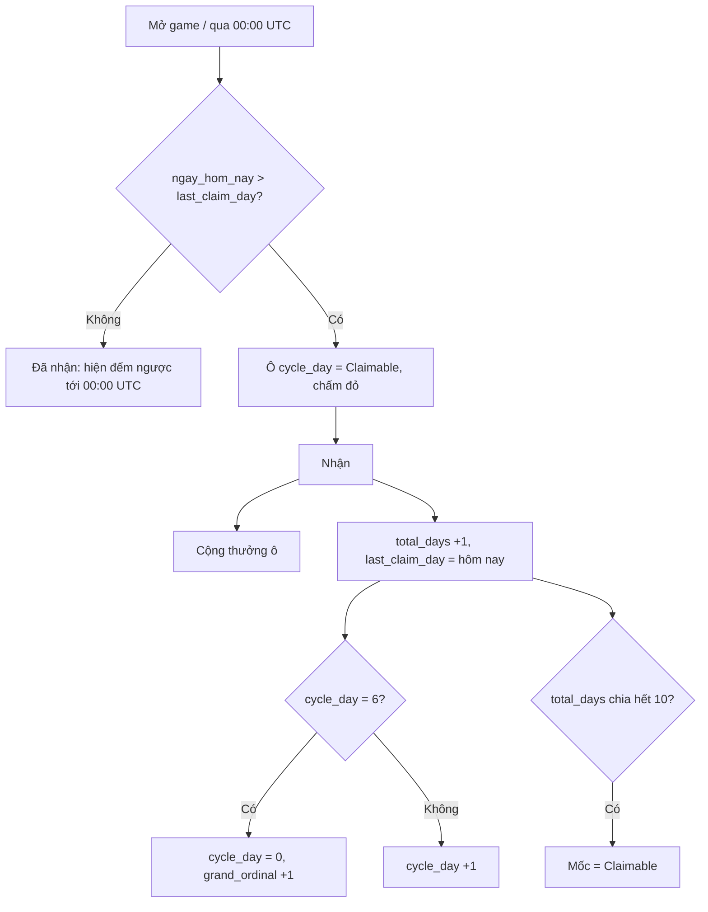

# 30 — Thưởng đăng nhập hằng ngày (Daily Rewards)

Ngày viết: 13/11/2026. Trạng thái: **P0, P1, P2 xong** (logic `game/daily_rewards.gd`, dữ liệu `data/daily_rewards.json`, popup `ui/daily_rewards_popup.gd`, nút Home + dòng Shop + chấm đỏ trong `ui/main.gd`, `ui/shop_page.gd`; test `daily_rewards_test`, `daily_rewards_ui_test`). P2 gồm popup tự bật (`_update_daily_auto` trong `ui/main.gd`) và hiệu ứng nhận. Còn P3 (video x2, analytics, Remote Config).

Nền tham chiếu: bản phân tích Daily Rewards của Race Star 1.9.0 (file ngoài repo). Từ đó chỉ lấy **cấu trúc** (vòng 7 ngày + ô Grand + thanh mốc cộng dồn + coupon là thưởng chính). Con số, thứ tự và các điểm "Unknown" của bản tham chiếu đều được định lại theo kinh tế game mình (05, 28).

Liên quan: [05 Kinh tế](05_Economy_Monetization.md) · [23 Tutorial](23_Tutorial_Script.md) · [26 Ads](26_Ads_Placements.md) · [28 Gói IAP](28_IAP_Packs.md) · [29 UI gói IAP](29_IAP_Packs_UI.md)

---

## 1. Quyết định đã chốt (mặc định, đổi được)

| # | Quyết định | Giá trị |
|---|---|---|
| R1 | Bỏ lỡ ngày | **Giữ tiến trình**, không lùi, không về ngày 1. Ngày bỏ lỡ không bù |
| R2 | Đồng hồ ngày | **00:00 UTC** (07:00 giờ VN), dùng chung với gói ngày và Pass tháng (28 §4.6, §4.7) |
| R3 | Mở khóa | Sau `U5_drivers` (23). Ngày mở khóa là **ngày 1, nhận được ngay** |
| R4 | Popup tự bật | **Một lần mỗi ngày** khi còn thưởng chưa nhận, không bật trong tutorial hay giữa trận quan trọng |
| R5 | Video nhân đôi | Có, chỉ nhân **phần gem** của ô ngày (§6) |
| R6 | Thanh mốc | Mỗi **10 ngày đã nhận**, thưởng xoay vòng 3 bậc (§4) |
| R7 | Nơi đặt | Thẻ đầu mục **QUÀ HẰNG NGÀY** trong Shop + nút/chấm đỏ ở Home (§5) |

---

## 2. Luồng

- Một ngày UTC nhận **tối đa một ô**. Bỏ ngày thì ô kế tiếp vẫn là ô kế tiếp (R1).
- Mỗi lần nhận tiến một ô, nên sau khi bỏ lỡ người chơi **không** nhận bù hai ô cùng ngày.

---

## 3. Vòng 7 ngày

### 3.1. Ô thường (ngày 1–6)

| Ngày | Thưởng | Gem tương đương |
|---:|---|---:|
| 1 | 2 coupon **Pro Pack** | 30 |
| 2 | 2 coupon **Standard Gear** | 30 |
| 3 | **15 gem** | 15 |
| 4 | 1 coupon **All-Star Pack** | 30 |
| 5 | 1 coupon **Elite Gear** | 30 |
| 6 | **20 gem** | 20 |
| | **Tổng 6 ngày** | **155** |

Giả định định giá (cùng 28 §3, §4.6): coupon All-Star và Elite ≈ 30 gem, Pro và Standard ≈ 15 gem. Phải kiểm tra lại trong lab nhịp tiến trình.

### 3.2. Ô Grand (ngày 7) — xoay vòng 7 chu kỳ

`grand_ordinal` chạy 0–6 rồi quay lại 0.

| Vòng | Thưởng | Gem tương đương |
|---:|---|---:|
| 0 | 2 coupon All-Star + 30 gem | 90 |
| 1 | 2 coupon Elite + 30 gem | 90 |
| 2 | 80 gem | 80 |
| 3 | 3 coupon All-Star | 90 |
| 4 | 3 coupon Elite | 90 |
| 5 | 2 coupon All-Star + 2 coupon Elite | 120 |
| 6 | 4 coupon All-Star + 2 coupon Elite + 50 gem | 230 |
| | **Trung bình** | **113** |

- Vòng 6 là "siêu Grand", đích dài hạn (49 ngày) và là lý do người chơi lâu năm vẫn quay lại.
- Không dùng "gói chọn tay đua" như bản tham chiếu, vì game mình không có cơ chế chọn tay đua theo gói. Tay đua vẫn đi qua gacha và bảng bảo đảm hiện có.
- Ô Grand mở gói thật ở tab Đội bằng coupon, **không** mở gacha tự động: thưởng chỉ là coupon vào ví.

---

## 4. Thanh mốc (theo `total_days`)

Mốc ở **10, 20, 30, 40, …**, thưởng xoay theo `k = total_days / 10`:

| k mod 3 | Thưởng | Gem tương đương |
|---:|---|---:|
| 1 | 40 gem | 40 |
| 2 | 2 coupon All-Star | 60 |
| 0 | 80 gem + 2 coupon All-Star | 140 |
| | **Trung bình / 10 ngày** | **80** |

- Mốc cộng dồn, không lặp theo chu kỳ 7 ngày, và tiếp tục vô hạn.
- Hiển thị cửa sổ **4 mốc**: giữ 1 mốc đã nhận gần nhất, mốc đang tới, và 2 mốc kế (rút gọn so với bản tham chiếu, màn hẹp).
- Mốc tự nhận cùng lúc với ô ngày chạm mốc, **không** cần bấm riêng. Một nút `Nhận` duy nhất, màn nhận thưởng hiện cả hai.

---

## 5. UI

### 5.1. Điểm vào

- **Home:** nút quà (đặt cạnh các nút phụ hiện có), chấm đỏ khi có thể nhận.
- **Shop:** thẻ đầu mục **QUÀ HẰNG NGÀY** (28 §5), dòng 1 là Daily Rewards, dòng 2 là gem Pass tháng nếu còn hạn. Chấm đỏ tab Shop lấy cùng điều kiện.
- Popup tự bật theo R4: tối đa một lần/ngày. Đóng popup là ghi `popup_shown_day`, không bật lại ngày đó dù chưa nhận.
- Chưa mở khóa (trước `U5_drivers`): ẩn hẳn, không khóa xám.

### 5.2. Popup (rộng 320–412 px)

Mẫu đã được người dùng duyệt và yêu cầu thay vào game ngày 14/11/2026. Ảnh chốt: `Design/Previews/daily_rewards_approved.png`. Giao diện triển khai dùng `assets/daily_rewards/skin.png` làm khung nền không chữ/không icon thưởng, đăng ký tọa độ theo đúng mẫu 922×1706; `today.png` cho trạng thái hôm nay và atlas `art.png` cho icon thưởng. Các Label, số lượng, nút và trạng thái nhận vẫn là Control thật, đọc dữ liệu trực tiếp. Canvas co đồng đều cả hai chiều để giữ đúng dáng ruy băng, thẻ quà và rương. Bản dựng bằng các khung phẳng trước đó đã bị người dùng từ chối và được thay thế.

- Ruy băng xanh, hộp quà và cờ đua ở đầu; tiêu đề “QUÀ HẰNG NGÀY”, nút X đỏ, số ngày đã nhận cập nhật theo tiến trình.
- Ngày 1–6: hai hàng, mỗi hàng ba thẻ. Ô hôm nay có nền và nhãn vàng đơn giản, không nhánh lúa. Ô đã nhận làm nhạt icon xuống 25%, số thưởng xuống 30%; nhãn xanh mint có dấu tick trắng và chữ “ĐÃ NHẬN” giữ độ rõ đầy đủ, nằm trong thẻ. Áp dụng cả quà ngày 7; không dùng dòng trạng thái sát mép dưới. Icon vé Pro, Standard, All-Star và Elite phân biệt theo màu và hình mũ bảo hiểm/dụng cụ.
- Ngày 7: thẻ xanh đậm viền vàng trọn hàng, rương bên trái, các phần thưởng tách thành ô icon và số lượng. Đọc đúng cả bảy vòng Grand; khi có ba loại quà thì dùng số lượng gọn dưới mỗi icon.
- Mốc tích lũy giữ thanh ngang nối bốn biểu tượng quà. Mốc có nhiều loại quà (ví dụ ngày 30) đặt icon cạnh nhau phía trên và số lượng tương ứng phía dưới, **không có đường kẻ dọc** giữa các loại quà.
- Bỏ các họa tiết caro nhỏ lặp lại ở góc thẻ và cạnh chú thích. Bề mặt ít bóng, màu xanh/vàng và chữ xanh đậm.
- Nút “NHẬN QUÀ” xanh lá, icon quà cạnh chữ; sau khi nhận đổi sang đếm ngược. Không thêm quảng cáo x2 trong pha này.
- Dữ liệu thưởng, lịch mở khóa, chu kỳ, mốc, quyền nhận, lưu tiến trình và popup tự bật giữ qua GameState/DailyRewards hiện có.

Ảnh chạy trong game: `Design/Previews/daily_rewards_approved_runtime_390.png`, `daily_rewards_320.png`, `daily_rewards_390.png`, `daily_rewards_412.png`, `daily_rewards_grand_runtime_320.png`.

Kiểm tra bằng `tests/daily_rewards_ui_test.gd`: bố cục và chữ ở 320/390/412 px, nhận và qua ngày, bảy vòng Grand tại 320 px, mốc hỗn hợp và popup tự bật. Logic thưởng kiểm tra riêng bằng `tests/daily_rewards_test.gd`. Chưa kiểm tra trên điện thoại thật.

---

## 6. Video nhân đôi

- Nút `Nhận x2` chỉ hiện khi ô hôm nay **có gem** (ngày 3, 6, và Grand vòng 0, 1, 2, 6).
- Nhân đôi **phần gem**, coupon giữ nguyên. Xem video thành công thì cộng gem gấp đôi, thất bại hoặc hủy thì không nhận gì thêm nhưng **thưởng thường vẫn nhận được**.
- Đặt tên vị trí quảng cáo: `ads_daily_x2`. Ghi vào bảng vị trí của 26. Mỗi ngày một lần, qua Horus SDK như các vị trí ads khác.
- Người mua Pass tháng vẫn thấy nút (không bán bỏ quảng cáo ở v1).

---

## 7. Lưu và chống gian lận

Thêm vào save hiện có (nhóm `daily_rewards`):

| Field | Kiểu | Ý nghĩa |
|---|---|---|
| `unlocked_day` | int | Ngày UTC mở khóa, 0 nếu chưa |
| `last_claim_day` | int | Ngày UTC (`unix / 86400`) nhận gần nhất |
| `cycle_day` | int 0–6 | Ô sẽ nhận kế |
| `grand_ordinal` | int 0–6 | Vòng Grand hiện tại |
| `total_days` | int | Tổng ngày đã nhận |
| `claimed_milestones` | int | Mốc cao nhất đã nhận (số lần ×10) |
| `popup_shown_day` | int | Ngày UTC popup đã tự bật |
| `max_seen_day` | int | Ngày lớn nhất từng thấy, chống lùi giờ |

Quy tắc ngày hiện tại: `hôm_nay = max(ngày_giờ_server_nếu_có, ngày_giờ_máy, max_seen_day)`. Cập nhật `max_seen_day = hôm_nay` mỗi lần mở game.

- Có mạng thì ưu tiên giờ server (05 §9). Không mạng dùng giờ máy, **chỉ chấp nhận tiến**.
- Chỉnh giờ máy **tiến** để nhận nhiều ô: chấp nhận ở v1 (thưởng nhỏ, chặn bằng `max_seen_day` chỉ ngăn lùi). Nếu soft launch thấy bị lạm dụng, chặn nhảy tiến quá 2 ngày so với giờ server lần cuối.
- Lưu đồng thời với ví trong cùng một lần ghi save: thưởng và `last_claim_day` không được lệch nhau khi tắt app giữa chừng.

---

## 8. Dữ liệu và kỹ thuật

- Bảng thưởng, rotation Grand, rotation mốc nằm ở **một file dữ liệu** (`assets/daily_rewards/config.tres` hoặc JSON, theo cách `assets/iap_offers`). Không viết cứng số trong `ui/*.gd`.
- Cờ Remote Config: `daily_rewards_enabled` (mặc định bật), `daily_gem_scale` (mặc định 1.0, chỉnh nhanh nếu lạm phát gem), `daily_x2_enabled`.
- Một script logic thuần (không phụ thuộc UI), ví dụ `systems/daily_rewards.gd`, có hàm thuần để test: `today()`, `can_claim()`, `claim()`, `preview(cycle_day, grand_ordinal)`, `milestone_state()`, `seconds_until_reset()`.
- UI chỉ gọi logic và vẽ: `ui/daily_rewards_popup.gd`, tích hợp vào `ui/main.gd` (Home) và `ui/shop_page.gd` (thẻ đầu mục).
- Sự kiện analytics: `daily_reward_claim {total_days, cycle_day, gem, coupons, x2}`, `daily_popup_shown`, `daily_x2_watch`.

---

## 9. Cân bằng

- Nguồn gem tương đương hằng ngày: ô thường 155 + Grand trung bình 113 → ~38/ngày, cộng mốc ~8/ngày → **~46 gem tương đương/ngày**.
- Gem thật (không tính coupon): ~12/ngày từ ô và mốc → rất nhỏ so với trần gem kiếm (05) và Pass tháng (30 gem/ngày).
- Bằng khoảng 40% gói ngày trả tiền (110 gem tương đương) nên **không cạnh tranh** với `daily_gear`/`daily_driver`. Nhưng so với Pass tháng thì quà free cao hơn về coupon; kiểm tra lại trong lab (28 §4.2).
- Rủi ro lớn nhất: lạm phát coupon All-Star/Elite làm giảm giá trị gói tuần và gói ngày. Công tắc: `daily_gem_scale` chỉ chỉnh gem. Để chỉnh coupon phải sửa file dữ liệu.

---

## 10. Kiểm thử

| Test | Kỳ vọng |
|---|---|
| Nhận lần đầu sau mở khóa | Ô ngày 1, `total_days = 1` |
| Nhận hai lần trong cùng ngày UTC | Lần hai bị từ chối |
| Bỏ 5 ngày rồi nhận | Vẫn ô kế tiếp, `cycle_day` không đổi |
| Nhận ô ngày 7 | `cycle_day = 0`, `grand_ordinal +1` |
| `grand_ordinal` đi hết 7 vòng | Quay lại 0 |
| `total_days = 10, 20, 30` | Đúng thưởng mốc theo `k mod 3` |
| Lùi giờ máy | `hôm_nay` không lùi, không nhận lại |
| Qua 00:00 UTC khi đang mở popup | Nút đổi sang nhận được mà không cần mở lại |
| Tắt app giữa lúc nhận | Không nhận thiếu hay nhận hai lần |
| Video x2 thất bại | Vẫn nhận thưởng thường |
| Trước `U5_drivers` | Điểm vào ẩn, popup không bật |

---

## 11. Phân kỳ

| Pha | Nội dung |
|---|---|
| P0 | Logic + dữ liệu + test (không UI) |
| P1 | Popup, nhận thưởng, thẻ trong Shop, chấm đỏ Home và tab Shop |
| P2 | Popup tự bật theo R4, thanh mốc đầy đủ, hiệu ứng nhận |
| P3 | Video x2 (`ads_daily_x2`), analytics, cờ Remote Config |

## 12. Câu hỏi còn mở

1. Cân giá trị coupon Pro/Standard (15) so với All-Star/Elite (30) cần kiểm tra bằng lab.
2. Có cần cho nhận bù một ngày bằng gem hoặc video không (chưa làm ở v1).
3. Có bán "bỏ quảng cáo" kèm Pass tháng không (ảnh hưởng nút x2).
4. Vị trí nút trên Home so với các nút phụ hiện có, cần xem thiết kế Home hiện tại khi làm P1.
