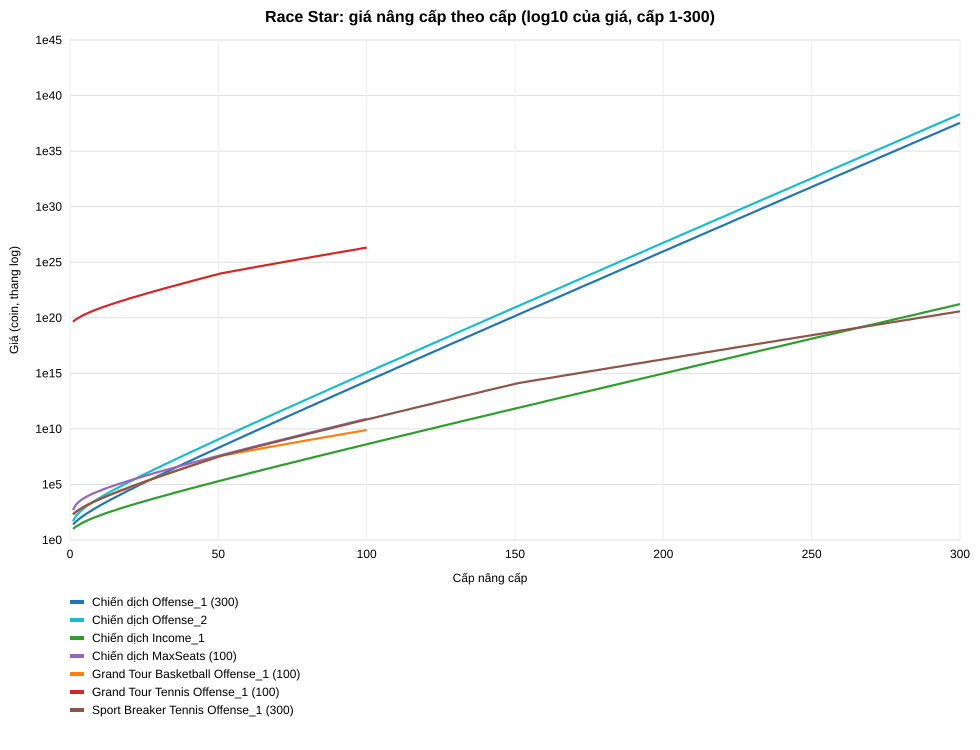

# Race Star: mức tăng tiến của bảng giá nâng cấp (v1.9.0)

Số liệu trích từ ScriptableObject trong APK (xem [race_star_upgrades_cars_tracks.md](race_star_upgrades_cars_tracks.md)). Mọi giá trị là **cấu hình tĩnh [Quan sát]**; mục *Nhận xét* là **[Suy luận]**.

Quy ước: `Giá(N)` là giá để mua **cấp N** (từ N-1 lên N). Số ≥ 1.000.000 viết dạng `a,bce k` = a,bc × 10^k. Chế độ chiến dịch dùng môn Basketball (6 môn có giá giống nhau).

## 1. Chiến dịch chính (Cash, tối đa 300 cấp; MaxSeats 100)

### 1.1. Giá mua cấp N

| Cấp | Offense_1 | Offense_2 | Defense_1 | Income_1 | Income_2 | Income_3 | MaxSeats |
|---:|---:|---:|---:|---:|---:|---:|---:|
| 1 | 25 | 50 | 35 | 10 | 50 | 150 | 500 |
| 2 | 45 | 143 | 63 | 16 | 103 | 379 | 1.490 |
| 3 | 76 | 287 | 106 | 23 | 171 | 674 | 2.770 |
| 5 | 185 | 828 | 259 | 45 | 367 | 1.520 | 6.470 |
| 10 | 1.210 | 6.250 | 1.700 | 161 | 1.440 | 6.220 | 27.000 |
| 20 | 31.400 | 173.000 | 44.000 | 1.220 | 11.500 | 50.800 | 223.000 |
| 30 | 634.000 | 3,60e6 | 888.000 | 7.250 | 69.600 | 309.000 | 1,36e6 |
| 50 | 1,97e8 | 1,14e9 | 2,76e8 | 194.000 | 1,89e6 | 8,45e6 | 3,74e7 |
| 75 | 2,06e11 | 1,21e12 | 2,89e11 | 9,49e6 | 9,33e7 | 4,17e8 | 1,85e9 |
| 100 | 1,93e14 | 1,14e15 | 2,71e14 | 4,14e8 | 4,09e9 | 1,83e10 | 8,13e10 |
| 150 | 1,43e20 | 8,53e20 | 2,01e20 | 6,70e11 | 6,65e12 | 2,98e13 | — |
| 200 | 9,52e25 | 5,66e26 | 1,33e26 | 9,66e14 | 9,60e15 | 4,31e16 | — |
| 250 | 5,92e31 | 3,52e32 | 8,29e31 | 1,30e18 | 1,30e19 | 5,84e19 | — |
| 300 | 3,53e37 | 2,10e38 | 4,94e37 | 1,69e21 | 1,69e22 | 7,59e22 | — |

### 1.2. Hệ số tăng giá so với cấp trước (Giá(N) / Giá(N-1))

| Cấp | Offense_1 | Offense_2 | Defense_1 | Income_1 | Income_2 | Income_3 | MaxSeats |
|---:|---:|---:|---:|---:|---:|---:|---:|
| 2 | ×1,800 | ×2,860 | ×1,800 | ×1,600 | ×2,060 | ×2,527 | ×2,980 |
| 3 | ×1,689 | ×2,007 | ×1,683 | ×1,438 | ×1,660 | ×1,778 | ×1,859 |
| 5 | ×1,542 | ×1,640 | ×1,533 | ×1,364 | ×1,422 | ×1,462 | ×1,467 |
| 10 | ×1,414 | ×1,447 | ×1,429 | ×1,258 | ×1,274 | ×1,280 | ×1,280 |
| 20 | ×1,365 | ×1,362 | ×1,366 | ×1,208 | ×1,208 | ×1,212 | ×1,212 |
| 30 | ×1,343 | ×1,343 | ×1,343 | ×1,189 | ×1,190 | ×1,193 | ×1,193 |
| 50 | ×1,331 | ×1,321 | ×1,327 | ×1,176 | ×1,174 | ×1,174 | ×1,176 |
| 75 | ×1,321 | ×1,314 | ×1,320 | ×1,166 | ×1,165 | ×1,165 | ×1,171 |
| 100 | ×1,313 | ×1,312 | ×1,316 | ×1,163 | ×1,162 | ×1,166 | ×1,161 |
| 150 | ×1,312 | ×1,308 | ×1,314 | ×1,157 | ×1,159 | ×1,160 | — |
| 200 | ×1,306 | ×1,307 | ×1,304 | ×1,156 | ×1,155 | ×1,155 | — |
| 250 | ×1,307 | ×1,304 | ×1,306 | ×1,150 | ×1,161 | ×1,154 | — |
| 300 | ×1,307 | ×1,304 | ×1,303 | ×1,150 | ×1,158 | ×1,153 | — |

### 1.3. Tổng tiền tích lũy để đạt cấp N

| Cấp | Offense_1 | Offense_2 | Defense_1 | Income_1 | Income_2 | Income_3 | MaxSeats |
|---:|---:|---:|---:|---:|---:|---:|---:|
| 1 | 25 | 50 | 35 | 10 | 50 | 150 | 500 |
| 2 | 70 | 193 | 98 | 26 | 153 | 529 | 1.990 |
| 3 | 146 | 480 | 204 | 49 | 324 | 1.203 | 4.760 |
| 5 | 451 | 1.813 | 632 | 127 | 949 | 3.763 | 15.640 |
| 10 | 3.801 | 18.583 | 5.319 | 655 | 5.568 | 23.543 | 101.190 |
| 20 | 114.931 | 626.543 | 160.989 | 6.595 | 60.898 | 266.323 | 1,17e6 |
| 30 | 2,46e6 | 1,39e7 | 3,44e6 | 43.915 | 417.498 | 1,84e6 | 8,13e6 |
| 50 | 7,98e8 | 4,62e9 | 1,12e9 | 1,29e6 | 1,26e7 | 5,61e7 | 2,48e8 |
| 75 | 8,55e11 | 5,02e12 | 1,20e12 | 6,64e7 | 6,52e8 | 2,91e9 | 1,29e10 |
| 100 | 8,10e14 | 4,78e15 | 1,13e15 | 2,96e9 | 2,92e10 | 1,31e11 | 5,81e11 |
| 150 | 6,07e20 | 3,61e21 | 8,51e20 | 4,91e12 | 4,87e13 | 2,18e14 | — |
| 200 | 4,06e26 | 2,41e27 | 5,68e26 | 7,16e15 | 7,11e16 | 3,19e17 | — |
| 250 | 2,53e32 | 1,51e33 | 3,54e32 | 9,74e18 | 9,69e19 | 4,35e20 | — |
| 300 | 1,51e38 | 9,01e38 | 2,12e38 | 1,27e22 | 1,27e23 | 5,69e23 | — |

### 1.4. Cần bao nhiêu cấp để giá tăng ×10 (Offense_1)

| Bắt đầu từ cấp | Giá | Số cấp để giá ×10 | Giá tại cấp đó |
|---:|---:|---:|---:|
| 1 | 25 | 5 | 278 |
| 5 | 185 | 7 | 2.410 |
| 10 | 1.210 | 7 | 12.300 |
| 20 | 31.400 | 8 | 351.000 |
| 30 | 634.000 | 8 | 6,49e6 |
| 50 | 1,97e8 | 9 | 2,45e9 |
| 75 | 2,06e11 | 9 | 2,45e12 |
| 100 | 1,93e14 | 9 | 2,23e15 |
| 150 | 1,43e20 | 9 | 1,61e21 |
| 200 | 9,52e25 | 9 | 1,05e27 |

### 1.5. Giá tăng bao nhiêu bậc 10 mỗi 10 cấp (Offense_1: log10 giá(N+10) − log10 giá(N))

| Khoảng cấp | Bậc 10 tăng thêm | Giá tại cuối khoảng |
|---|---:|---:|
| 10 → 20 | +1,41 | 31.400 |
| 30 → 40 | +1,26 | 1,15e7 |
| 50 → 60 | +1,22 | 3,24e9 |
| 70 → 80 | +1,20 | 8,17e11 |
| 90 → 100 | +1,19 | 1,93e14 |
| 110 → 120 | +1,18 | 4,40e16 |
| 130 → 140 | +1,17 | 9,74e18 |
| 150 → 160 | +1,17 | 2,11e21 |
| 170 → 180 | +1,16 | 4,51e23 |
| 190 → 200 | +1,16 | 9,52e25 |
| 210 → 220 | +1,16 | 1,99e28 |
| 230 → 240 | +1,16 | 4,12e30 |
| 250 → 260 | +1,16 | 8,48e32 |
| 270 → 280 | +1,16 | 1,73e35 |
| 290 → 300 | +1,16 | 3,53e37 |

### 1.6. Giá mua cho mỗi đơn vị hiệu ứng tăng thêm (cấp N)

Giá(N) / (Hiệu ứng(N) − Hiệu ứng(N−1)). Hiệu ứng tăng đều mỗi cấp nên cột này tỉ lệ thuận với giá.

| Cấp | Offense_1 | Offense_2 | Defense_1 | Income_1 | Income_2 | Income_3 | MaxSeats |
|---:|---:|---:|---:|---:|---:|---:|---:|
| 1 | 12.5 | 16.67 | 17.5 | 200 | 333 | 600 | 100 |
| 10 | 605 | 2.083 | 850 | 3.220 | 9.600 | 24.880 | 5.400 |
| 50 | 9,85e7 | 3,80e8 | 1,38e8 | 3,88e6 | 1,26e7 | 3,38e7 | 7,48e6 |
| 100 | 9,65e13 | 3,80e14 | 1,35e14 | 8,28e9 | 2,73e10 | 7,32e10 | 1,63e10 |
| 200 | 4,76e25 | 1,89e26 | 6,65e25 | 1,93e16 | 6,40e16 | 1,72e17 | — |
| 300 | 1,76e37 | 7,00e37 | 2,47e37 | 3,38e22 | 1,13e23 | 3,04e23 | — |

## 2. Grand Tour (Cash, tối đa 100 cấp)

### 2.1. Giá mua cấp N theo nâng cấp (môn Basketball)

| Cấp | Offense_1 | Offense_2 | Income_1 | Income_2 | Income_3 | MaxSeats |
|---:|---:|---:|---:|---:|---:|---:|
| 1 | 200 | 400 | 100 | 300 | 900 | 2.500 |
| 2 | 336 | 1.100 | 168 | 648 | 2.370 | 8.450 |
| 3 | 518 | 2.120 | 259 | 1.120 | 4.400 | 17.700 |
| 5 | 1.070 | 5.660 | 539 | 2.610 | 10.800 | 52.800 |
| 10 | 4.740 | 35.100 | 2.370 | 12.600 | 54.700 | 408.000 |
| 20 | 54.900 | 660.000 | 27.400 | 155.000 | 684.000 | 1,14e7 |
| 30 | 498.000 | 9,25e6 | 249.000 | 1,43e6 | 6,37e6 | 2,38e8 |
| 50 | 3,12e7 | 1,34e9 | 1,56e7 | 9,14e7 | 4,08e8 | 7,60e10 |
| 75 | 5,48e8 | 2,47e10 | 2,74e8 | 1,61e9 | 7,24e9 | 8,06e13 |
| 100 | 7,88e9 | 3,58e11 | 3,94e9 | 2,33e10 | 1,04e11 | 7,60e16 |

### 2.2. Giá mua cấp N của Offense_1 theo môn (RouteOrder 1→7)

| Cấp | Basketball | Soccer | Hockey | Football | Volleyball | Baseball | Tennis |
|---:|---:|---:|---:|---:|---:|---:|---:|
| 1 | 200 | 2,40e6 | 4,40e8 | 9,40e10 | 4,20e13 | 2,60e16 | 4,40e19 |
| 5 | 1.070 | 1,29e7 | 2,37e9 | 4,27e11 | 1,90e14 | 1,18e17 | 2,00e20 |
| 10 | 4.740 | 5,69e7 | 1,04e10 | 1,52e12 | 6,79e14 | 4,20e17 | 7,12e20 |
| 25 | 168.000 | 2,02e9 | 3,70e11 | 2,85e13 | 1,27e16 | 7,88e18 | 1,33e22 |
| 50 | 3,12e7 | 3,74e11 | 6,87e13 | 1,82e15 | 8,15e17 | 5,04e20 | 8,54e23 |
| 75 | 5,48e8 | 6,58e12 | 1,20e15 | 3,07e16 | 1,37e19 | 8,49e21 | 1,43e25 |
| 100 | 7,88e9 | 9,46e13 | 1,73e16 | 4,41e17 | 1,97e20 | 1,22e23 | 2,06e26 |

### 2.3. Hệ số tăng giá Offense_1 theo môn

| Cấp | Basketball | Soccer | Hockey | Football | Volleyball | Baseball | Tennis |
|---:|---:|---:|---:|---:|---:|---:|---:|
| 2 | ×1,680 | ×1,679 | ×1,680 | ×1,606 | ×1,610 | ×1,608 | ×1,609 |
| 5 | ×1,408 | ×1,414 | ×1,419 | ×1,360 | ×1,357 | ×1,358 | ×1,361 |
| 10 | ×1,313 | ×1,314 | ×1,310 | ×1,267 | ×1,260 | ×1,257 | ×1,260 |
| 25 | ×1,244 | ×1,247 | ×1,246 | ×1,197 | ×1,198 | ×1,194 | ×1,198 |
| 50 | ×1,224 | ×1,222 | ×1,225 | ×1,174 | ×1,173 | ×1,172 | ×1,173 |
| 75 | ×1,114 | ×1,115 | ×1,111 | ×1,116 | ×1,114 | ×1,116 | ×1,117 |
| 100 | ×1,111 | ×1,112 | ×1,109 | ×1,111 | ×1,113 | ×1,119 | ×1,114 |

### 2.4. Giá cấp 1 và hệ số giữa hai môn liên tiếp (Offense_1)

| Môn | Giá cấp 1 | Nhân so với môn trước | Giá cấp 100 | Giá cấp100/cấp1 |
|---|---:|---:|---:|---:|
| Basketball | 200 | — | 7,88e9 | 3,94e7 |
| Soccer | 2,40e6 | ×12.000 | 9,46e13 | 3,94e7 |
| Hockey | 4,40e8 | ×183 | 1,73e16 | 3,93e7 |
| Football | 9,40e10 | ×214 | 4,41e17 | 4,69e6 |
| Volleyball | 4,20e13 | ×447 | 1,97e20 | 4,69e6 |
| Baseball | 2,60e16 | ×619 | 1,22e23 | 4,69e6 |
| Tennis | 4,40e19 | ×1.692 | 2,06e26 | 4,68e6 |

## 3. Sport Breaker (Tennis, tối đa 300 cấp; MaxSeats 100)

### 3.1. Giá mua cấp N

| Cấp | Offense_1 | Offense_2 | Income_1 | Income_2 | Income_3 | MaxSeats |
|---:|---:|---:|---:|---:|---:|---:|
| 1 | 200 | 400 | 100 | 300 | 900 | 2.500 |
| 2 | 336 | 1.100 | 168 | 648 | 2.370 | 8.450 |
| 3 | 518 | 2.120 | 259 | 1.120 | 4.400 | 17.700 |
| 5 | 1.070 | 5.660 | 539 | 2.610 | 10.800 | 52.800 |
| 10 | 4.740 | 35.100 | 2.370 | 12.600 | 54.700 | 408.000 |
| 20 | 54.900 | 660.000 | 27.400 | 155.000 | 684.000 | 1,14e7 |
| 30 | 498.000 | 9,25e6 | 249.000 | 1,43e6 | 6,37e6 | 2,38e8 |
| 50 | 3,12e7 | 1,34e9 | 1,56e7 | 9,14e7 | 4,08e8 | 7,60e10 |
| 75 | 1,59e9 | 7,20e10 | 7,97e8 | 4,70e9 | 2,10e10 | 8,06e13 |
| 100 | 6,96e10 | 3,16e12 | 3,48e10 | 2,06e11 | 9,24e11 | 7,60e16 |
| 150 | 1,12e14 | 5,14e15 | 5,63e13 | 3,35e14 | 1,50e15 | — |
| 200 | 1,83e16 | 8,42e17 | 9,19e15 | 5,48e16 | 2,46e17 | — |
| 250 | 2,69e18 | 1,23e20 | 1,34e18 | 8,04e18 | 3,61e19 | — |
| 300 | 3,79e20 | 1,74e22 | 1,89e20 | 1,13e21 | 5,08e21 | — |

### 3.2. Sport Breaker so với Grand Tour (Offense_1): chỗ hai bảng tách nhau

| Cấp | Grand Tour (Basketball) | Sport Breaker (Tennis) | SB / GT |
|---:|---:|---:|---:|
| 10 | 4.740 | 4.740 | ×1,000 |
| 30 | 498.000 | 498.000 | ×1,000 |
| 50 | 3,12e7 | 3,12e7 | ×1,000 |
| 51 | 3,82e7 | 3,82e7 | ×1,000 |
| 52 | 4,28e7 | 4,47e7 | ×1,044 |
| 55 | 6,02e7 | 7,19e7 | ×1,194 |
| 60 | 1,05e8 | 1,57e8 | ×1,495 |
| 70 | 3,18e8 | 7,40e8 | ×2,327 |
| 80 | 9,41e8 | 3,41e9 | ×3,624 |
| 90 | 2,74e9 | 1,55e10 | ×5,657 |
| 100 | 7,88e9 | 6,96e10 | ×8,832 |

## 4. Nâng cấp Trophy (tuyến tính)

Giá mua cấp N = N trophy ở cả ba chế độ (đã xác minh từ dữ liệu). Tổng tích lũy = N(N+1)/2.

| Cấp | Giá cấp N | Tổng tích lũy |
|---:|---:|---:|
| 1 | 1 | 1 |
| 5 | 5 | 15 |
| 10 | 10 | 55 |
| 25 | 25 | 325 |
| 50 | 50 | 1275 |
| 75 | 75 | 2850 |

## 5. Biểu đồ

Trục dọc là log10 của giá, nên mỗi đường gần như thẳng. Độ dốc của đường là số bậc 10 tăng thêm mỗi cấp.

## 6. Nhận xét

**[Quan sát]** (đọc trực tiếp từ các bảng trên)
1. **Hệ số tăng giá giảm dần rồi gần như cố định.** Chiến dịch Offense_1: ×1,80 (cấp 2), ×1,41 (cấp 10), ×1,34 (cấp 30), ×1,31 từ cấp 100 trở đi. Nâng cấp Income dừng ở khoảng ×1,15–1,16. Offense_2 và MaxSeats bắt đầu cao hơn (×2,86 và ×2,98 ở cấp 2) rồi hội tụ về mức của nhóm cùng loại.
2. **Giá tăng ×10 sau khoảng 9 cấp** ở giai đoạn cuối của Offense_1 (mục 1.4), tức mỗi 10 cấp tăng thêm khoảng 1,16 bậc 10 (mục 1.5). Từ cấp 1 chỉ cần 5 cấp để giá tăng ×10.
3. **Hiệu ứng tuyến tính, giá hàm mũ.** Chi phí trên mỗi đơn vị hiệu ứng (mục 1.6) tăng gần như cùng tốc độ với giá: Offense_1 từ 12,5 (cấp 1) lên 1,76e37 (cấp 300).
4. **Grand Tour đổi hệ số tăng giá trong khoảng L50 đến L75.** Tới L50 hệ số là ×1,22 (Basketball, Soccer, Hockey) hoặc ×1,17 (từ Football trở đi). Ở L75 hệ số là ×1,11 cho cả 7 môn (mục 2.3). Tôi chưa xác định cấp chính xác nơi đổi.
5. **Sport Breaker trùng Grand Tour tới L51 rồi tách ra:** Sport Breaker giữ hệ số cao hơn nên đắt gấp 8,8 lần ở L100 (mục 3.2), rồi tiếp tục tới L300.
6. **Giá cấp 1 ở Grand Tour nhảy rất mạnh theo môn** (mục 2.4): ×12.000 (Basketball → Soccer), ×183, ×214, ×447, ×619, ×1.692. Tỉ lệ giá cấp 100 / cấp 1 chỉ có hai giá trị: 3,9e7 (3 môn đầu) và 4,7e6 (4 môn sau).
7. **Nâng cấp Trophy tuyến tính hoàn toàn:** cấp N tốn N trophy, tổng tích lũy N(N+1)/2. Chương trình đã kiểm tra đúng với toàn bộ nâng cấp Trophy của ba chế độ.

**[Suy luận]**
- Hệ số hội tụ về hằng số (×1,31 cho Offense, ×1,15 cho Income) gợi ý bảng giá sinh từ công thức dạng `a·b^N` kèm điều chỉnh ở các cấp đầu. Tôi chưa tìm ra công thức, nên không nên dùng các hằng số trên làm công thức gốc.
- Việc Grand Tour đổi hệ số có thể có chủ ý (làm phẳng đoạn cuối) hoặc do cắt bảng. Chưa có bằng chứng để phân biệt.

**[Chưa biết]**
- Bảng này chỉ là giá. Thu nhập theo thời gian, vốn quyết định tốc độ mua thực tế, nằm trong mã `libil2cpp.so`, chưa giải mã.
- Giá thật trong game có thể khác do Remote Config hoặc server ghi đè.
