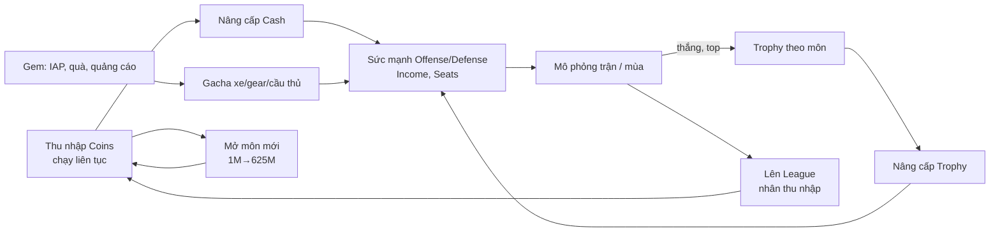

# Race Star – Team Manager: tài liệu thiết kế (suy ra từ bản 1.9.0)

- Nguồn: `Race+Star+-+Team+Manager+Game_1.9.0_APKPure.xapk` (gói `com.coolcatsgames.racestaridle`, versionCode 1020).
- Phương pháp: phân tích tĩnh APK (manifest, danh sách assembly, metadata IL2CPP, ScriptableObject cấu hình). Không chạy game, không quan sát runtime, chưa giải mã `libil2cpp.so`.
- Quy ước nhãn:
  - **[Quan sát]**: đọc trực tiếp từ file trong gói.
  - **[Suy luận]**: rút ra từ tên lớp, tên khóa hoặc cấu trúc dữ liệu.
  - **[Chưa biết]**: không có bằng chứng trong phạm vi đã phân tích.
- Giới hạn chung: số liệu là cấu hình tĩnh của APK. Server (Nakama, Firebase Remote Config) có thể ghi đè giá, tỉ lệ và offer đang chạy. Bản này là bản APKPure đã đóng lại, chữ ký không phải chữ ký gốc của nhà phát hành.

---

## 1. Tổng quan

| Mục | Nội dung |
|---|---|
| Thể loại | **[Suy luận]** Idle/manager: tiền chạy liên tục, người chơi chọn nâng cấp nào, mở môn nào, đầu tư xe/gear/tay đua nào |
| Engine | **[Quan sát]** Unity 6000.0.62f1, IL2CPP, metadata v31, Addressables 2.7.4 |
| Nền tảng | **[Quan sát]** Android, minSdk 31, targetSdk 36. Split chỉ có `armeabi-v7a` trong XAPK này |
| Chủ đề | **[Quan sát]** Đua xe. Tên xe theo loại: Racing, Stock, Rally, Superbike, Monster, Speedster |
| Khung "môn thể thao" | **[Quan sát]** Dữ liệu dùng 6 nhãn Basketball, Soccer, Hockey, Football, Baseball, Volleyball. **[Suy luận]** Đây là khung kinh tế chung của một game thể thao, được gắn chủ đề xe đua: mỗi "môn" ứng với một loại xe (Basketball = Racing, Soccer = Stock, Hockey = Rally, Football = Superbike, Baseball = Monster, Volleyball = Speedster) |
| Mô hình kinh doanh | **[Quan sát]** Free-to-play, IAP (Unity IAP + Google Play Billing), quảng cáo thưởng qua AppLovin MAX |
| Live service | **[Quan sát]** Có Guild, Chat, Leaderboard, Battle Pass, Monthly Pass, Lucky Draw, offer theo sự kiện (Halloween) |

### Vòng lặp chính (suy luận)

---

## 2. Kiến trúc kỹ thuật

### 2.1. Công nghệ **[Quan sát]**
- Dependency injection: Zenject (Extenject-Async).
- Reactive: R3. Async: UniTask. Tween: DOTween. Inspector/serialization dữ liệu: Odin Inspector (cấu hình ScriptableObject dùng định dạng Odin binary).
- Backend: Nakama (Heroic Labs), có hai host `*.nakamacloud.io` (prod, dev, vùng eu-west1) và assembly Satori.
- Dịch vụ: Firebase (Analytics, Auth, Realtime Database, Remote Config, Crashlytics), Google Play Games v2, Facebook SDK, Singular 12.10.0, Unity Analytics, TikTok plugin.
- Quảng cáo: AppLovin MAX với adapter Google, Meta Audience Network, Unity Ads, Vungle, InMobi, Fyber, Mintegral, Pangle/TikTok, Moloco.
- Bảo vệ: Pairip `LicenseActivity` (kiểm tra license Google Play), Google Play Integrity, `TimeTravelDetection`, `CheatDetection`.

### 2.2. Phân lớp mã **[Suy luận từ tên assembly]**

| Lớp | Ví dụ assembly | Vai trò |
|---|---|---|
| `Core.*` | Upgrades, Rewards, Iap, AdsMediation, Analytics, SaveGame, Timers, UsageLimit, RecoverableUsage, Popups, Localization, Haptics | Hạ tầng dùng chung, mỗi module tách Public/Private |
| `Features.*` | Garage, SportTeam, SportTeamGear, SportTeamPlayers, MatchSimulation, GrandTour, SportBreaker, Adventures, Guilds, GuildConquest, BattlePass, MonthlyPass, GrowthFund, LuckyDraw, Quest, SkillTree, DailyRewards, OfflineIncome, Offers*, Shop, Leaderboard, Chat, Collections | Từng tính năng độc lập, giao tiếp qua DI |
| `Backend.*` | Connection, Iap, PlayerProfile, Leaderboard, Guilds, GuildChat, GuildConquest, CupLeagues, CupSeason, MailboxMessages, CheatDetection | Client gọi server (Nakama) |

### 2.3. Dữ liệu cấu hình
- **[Quan sát]** Cân bằng nằm trong ScriptableObject trong `globalgamemanagers.assets` và `sharedassets0.assets`, định dạng Odin, không phải JSON.
- **[Quan sát]** Một số cấu hình trống trong APK (`OfflineIncomeBaseConfig`, `TimeTravelDetectionConfig`, `GemsRecoverableUsageConfig`, `AdUsageGemsLimitConfig`). **[Suy luận]** Giá trị lấy từ Remote Config hoặc server.

---

## 3. Tiền tệ và tài nguyên

| Tiền tệ | Loại | Nguồn | Chi tiêu | Nhãn |
|---|---|---|---|---|
| `Coins` | Mềm | Thu nhập idle, offline, thưởng | Nâng cấp Cash, mở môn mới | Quan sát |
| `{Sport}Trophy` (6 loại) | Mềm, theo môn | Thi đấu | Nâng cấp Trophy của đúng môn | Quan sát |
| `Gems` | Cao cấp | IAP, daily, Battle Pass, quảng cáo | Lucky Draw, gear pack | Quan sát |
| `Key_Player_StarterPack`, `Key_Player_ProPack` | Vé | Thưởng, offer | Mở gói cầu thủ | Quan sát |
| `Key_Gear_StarterPack`, `Key_Gear_ProPack` | Vé | Thưởng, offer | Mở gói gear | Quan sát |
| `CareerPlayer` | Điểm | Lên league (hệ số XP) | Skill tree | Quan sát |
| `BattlePoints` | Điểm | Quest ngày/tuần | Lên level Battle Pass | Quan sát |
| Shard (xe, skin, người) | Mảnh | Gacha, trùng lặp | Nâng cấp | Quan sát (tên `ShardBundle_*`, `DuplicateShardBundle`) |

Tiền lớn tới ~10³⁹ coin trong một nâng cấp, nên game cần kiểu số lớn. **[Suy luận]**

---

## 4. Nâng cấp chiến dịch (`CampaignUpgradesConfig`)

**[Quan sát]** 102 nâng cấp, 13.428 mức.

| Nhóm | Số lượng | Max level | Chi phí | Hiệu ứng |
|---|---|---|---|---|
| Cash | 8 mỗi môn (Offense ×2, Defense ×2, Income ×3, MaxSeats) | 300 (MaxSeats 100) | `Coins` | Tuyến tính theo mức |
| Trophy | 6 mỗi môn (Offense ×2, Defense ×2, Income ×2) | 75 | Trophy của môn | Tuyến tính |
| League | 3 mỗi môn (MaxTrophies, Income, CareerPlayerXP) | 9 | 0 coin | Bậc theo league |

### 4.1. Hiệu ứng mỗi mức **[Quan sát]**
- Offense_1: +2 %; Offense_2: +3 % (Defense tương tự: +2 và +3).
- Income_1: +0,05; Income_2: +0,15; Income_3: +0,25 (giá trị đơn vị income, mức đầu của Income_1 là 0,1).
- MaxSeats: +5 chỗ mỗi mức, bắt đầu từ 10.
- Trophy Offense/Defense: +10 mỗi mức; Trophy Income: +20 mỗi mức (khóa tên là `*_percentage`).

### 4.2. Đường chi phí **[Quan sát]**
- Chi phí cấp 1 → tăng dần: Offense_1 là 25, 45, 76, 185 (L5), 1.210 (L10), 1,43·10⁵ (L25).
- Hệ số tăng chi phí mỗi mức giảm dần theo cấp:

| Nâng cấp | L1→2 | L10→11 | L50→51 | L100→101 | L299→300 |
|---|---:|---:|---:|---:|---:|
| Offense_1 | ×1,80 | ×1,42 | ×1,33 | ×1,32 | ×1,31 |
| Income_1 | ×1,60 | ×1,26 | ×1,17 | ×1,16 | ×1,15 |
| Income_2 | ×2,06 | ×1,26 | ×1,18 | ×1,16 | ×1,16 |
| Income_3 | ×2,53 | ×1,27 | ×1,17 | ×1,16 | ×1,15 |

- Tổng chi phí tới max (Basketball): Income_1 ≈ 1,3·10²² coin, Income_3 ≈ 5,7·10²³, Offense/Defense từ 1,5·10³⁸ đến 1,3·10³⁹.
- Từ L50 lên L100 của Income_1: chi phí ×2.130, income chỉ ×1,96. **[Suy luận]** Nâng cấp coin chậm dần nhanh chóng; tiến trình chính phải đến từ league và trophy.

### 4.3. Tính chất cân bằng **[Quan sát]**
- Bảng của 6 môn giống hệt nhau: mọi nâng cấp cùng tên trùng khớp với sai số 0. Môn thể thao không tạo khác biệt giá.
- **Đính chính (phát hiện sau):** nhận định này chỉ đúng với **chiến dịch chính**. Chế độ **Grand Tour** có 7 môn (thêm Tennis) và giá tăng mạnh theo môn (môn sau đắt hơn tới 10¹⁷ lần). Chế độ **Sport Breaker** chỉ có Tennis. Xem [race_star_upgrades_cars_tracks.md](race_star_upgrades_cars_tracks.md).

### 4.4. Nâng cấp Trophy **[Quan sát]**
- Cấp N tốn N trophy của môn (1, 2, 3, …).
- Tổng để max một môn: 17.100 trophy (6 nâng cấp × tổng 1…75 = 2.850 mỗi cái).
- Max: Offense/Defense +750 mỗi cái, Income +1.500 mỗi cái (theo đơn vị `percentage`).

---

## 5. League, độ khó và hệ số thu nhập

### 5.1. Hệ số theo league (mỗi môn) **[Quan sát]**

| League | 0 | 1 | 2 | 3 | 4 | 5 | 6 | 7 | 8 | 9 |
|---|---:|---:|---:|---:|---:|---:|---:|---:|---:|---:|
| Income ×| 1 | 10 | 50 | 200 | 500 | 1.000 | 2.000 | 4.000 | 8.000 | 16.000 |
| Trần trophy | 100 | 300 | 600 | 1.000 | 1.500 | 2.100 | 2.800 | 3.600 | 4.500 | 5.500 |
| XP cầu thủ ×| 1 | 2 | 3 | 4 | 5 | 6 | 7 | 8 | 9 | 10 |

- Chi phí của nâng cấp League bằng 0 coin: chuyển league là điều kiện, không phải mua.
- **[Suy luận]** Đây là cơ chế vượt tường chính. Tổng trophy cần để max một môn (17.100) lớn hơn trần cao nhất (5.500) nên không thể max tất cả.

### 5.2. Đối thủ (`SportLeaguesConfig`) **[Quan sát]**
- 10 league × 9 đội mỗi league, sức mạnh đội thay đổi theo `unlockOrder` (thứ tự mở môn).
- `unlockOrder` 0: league 0 từ 40 đến 200; league 5 từ 3.990 đến 11.700; league 9 từ 50.190 đến 95.700.
- Sức mạnh league 9, đội đầu: 50.190 (order 0), 54.707 (order 3), 57.718 (order 5). **[Suy luận]** Đối thủ mạnh hơn khi người chơi đã mở nhiều môn.

### 5.3. Mở môn mới **[Quan sát]**
Giá theo số môn đã sở hữu: 0 → miễn phí; 1 → 1M; 2 → 5M; 3 → 25M; 4 → 125M; 5 → 625M coin (hệ số ×5, tổng 781M).

---

## 6. Xe, gear, cầu thủ

### 6.1. Xe (`GarageConfig`) **[Quan sát]**
- 4 xe mỗi môn, rarity 0, 2000, 3000, 4000. Mỗi xe có 11 mức.
- Hiệu ứng khi sở hữu (Basketball, L0 → L10): Rare 20 → 120, Epic 50 → 250, Legendary 100 → 400 (cho cả offense và defense).
- Bonus khi trang bị cho mọi môn: Rare +10 %, Epic +20 %, Legendary +50 % (offense và defense).
- Chi phí nâng cấp (đơn vị chưa rõ, **[Suy luận]** có thể là shard): tổng L0–L10: Rare 4.175, Epic 1.975, Legendary 600. Rarity cao rẻ hơn.
- Xe trùng quy đổi thành shard (`DuplicateShardBundle`: 343, 353, 363).
- `CarUnlockConfig`: xe rarity 0 mặc định, xe Rare mở bằng 500 (đơn vị chưa xác định), xe Epic gắn với phần thưởng cụ thể, xe Legendary loại riêng.

### 6.2. Gear **[Quan sát]**
- 8 món mỗi môn trong `GarageConfig`, 25 mức mỗi món; món đầu +20 mỗi mức (20 → 500).
- `SportTeamGearConfig` liệt kê 10 món mỗi rarity (Rare 2000, Epic 3000, Legendary 4000) cho từng môn.
- Gear pack: 10 gem mỗi gói (x1).

### 6.3. Cầu thủ **[Quan sát]**
- Giá bán theo rarity: Common 10, Uncommon 20, Rare 50, Epic 150, Legendary 450, Mythic 1.500.
- Cầu thủ unique: có tên, chỉ số cố định (Basketball: 150/150), bán trực tiếp qua IAP (10 người × 6 môn).
- Gói chọn cầu thủ: `ChoicePack_Player_E/L/M/U` (nhiều khả năng Epic, Legendary, Mythic, Unique).

### 6.4. Skill tree nhân vật (`CareerPlayerSkillsConfig`) **[Quan sát]**
- 189 node, mỗi node 1 mức, tổng 392 điểm `CareerPlayer`.
- Node có điều kiện mở (node tiên quyết). Ví dụ node 1: +10 offense/defense; node 2: +25; node 3: +45.

---

## 7. Gacha: Lucky Draw **[Quan sát]**

- 13 rotation, chủ đề Players hoặc Skins. Mỗi rotation có 10 slot với trọng số tổng 100.
- Tỉ lệ rotation 0 (Players): 24,5 / 20 / 13 / 13 / 10 / 7 / 5 / 5 / 2 / **0,5** %. Phần thưởng 0,5 % là cầu thủ unique; 2 % là gói Mythic.
- Rotation Skins: cùng cấu trúc, skin Legendary cao nhất 0,5 %.
- Giá lượt quay tăng dần (gem): 20, 60, 120, 200, 300, 400, 600, 1.000, 1.600, 2.400 (tổng 10 lượt 6.700).
- Phần thưởng trùng được thay bằng shard (`_replacementRewardsData`).
- **[Chưa biết]** Có cơ chế pity ngoài trọng số hay không.

---

## 8. Chương trình tiến trình

### 8.1. Daily rewards **[Quan sát]**
- Chu kỳ 7 ngày: ngày 1 và 2 vé gói (5), ngày 3 20 gem, ngày 4 và 5 vé Pro (2), ngày 6 30 gem, ngày 7 gói chọn cầu thủ (`IsGrand`).
- Mốc cộng dồn: ngày 10, 17, 24, 31 mỗi mốc 50 gem.

### 8.2. Battle Pass **[Quan sát]**
- 3 rotation, 30 level mỗi rotation, chi phí level từ 30 tăng dần (65, 105, 150, …, 2.900); tổng 33.350 `BattlePoints`; level lặp lại 250.
- 3 tầng thưởng: Normal, Premium, Premium Plus. Thưởng Premium Plus thường gấp 5 lần Premium cho gem (Level 10: 5 / 20 / 100 gem).
- Quest ngày và tuần, mỗi quest 10 `BattlePoints`. Loại quest: ghi điểm, chơi trận, thắng trận, hoàn thành mùa, tiêu gem.
- `PremiumDiscount` 750 và `PremiumPlusDiscount` 1.000 (đơn vị chưa rõ).

### 8.3. Growth Fund (SportBreaker, GrandTour) **[Quan sát]**
- Hai tầng IAP: Rookie và Champion, cộng với lane miễn phí. Mốc đầu: 5 / 30 / 150 gem; các mốc sau thưởng vé gear và vé cầu thủ.

### 8.4. Monthly Pass **[Quan sát]**
- `DoubleSpeed`: bonus loại 0 (giá trị 1), thưởng mua 255 gem.
- `OfflineGems`: bonus loại 2 (giá trị 1) và loại 1 (giá trị 600), thưởng mua 520 gem.
- `DailyGems`: 50 gem mỗi ngày, thưởng mua 255 gem.

### 8.5. Nội dung xã hội và cạnh tranh
- **[Quan sát]** Guild, Guild Conquest (có bảng thưởng), Chat, Leaderboard (bảng thưởng theo hạng, có `WildReward`), Cup (season, recurring, sport, leagues), Adventures, Adventures Arena, Grand Tour (có `GrandTourLocationsConfig`).
- **[Chưa biết]** Luật chi tiết của từng chế độ.

---

## 9. Monetization

### 9.1. Offer **[Quan sát]**
- `OfferRotationConfig`: ưu tiên hiển thị: UniquePlayerOffer 9999, NoAds 400, IncomeX2 300, MonthlyPass 300, IncomeX3 100, StarterPack 0, OfflineIncomeOffer 0. Chờ 30 giây trước khi trận kết thúc, cooldown 120 giây.
- Starter Pack: 255 gem, 500.000 coin, một avatar và một khung.
- Chain Offer: chuỗi gói tăng dần có `Discount` (ví dụ player chain: 5 vé + 50 gem, rồi 10 vé + 100 gem).
- Limited Offer: xoay theo rotation, có `Limit` mua.
- Choose-One Offer: ba cỡ S/M/L/All, mỗi gói gồm gem, shard và vé.
- Festive Offer: Halloween (3 gói), `ValuePercent` 850 cho gói đầu.
- Unique Player Offer: chuỗi 10 cầu thủ mỗi môn.

### 9.2. IAP **[Quan sát]**
94 mã sản phẩm xuất hiện trong cấu hình (`*UniquePlayer0..9`, `ChooseOneOffer_*`, `LimitedQuantityOffer_*`, `SeasonalOfferHalloween*`, `MonthlyPass*`, `*RewardLane*`). Các mã không có trong bảng đã đọc nhưng được tham chiếu trong offer: `NoAds`, `IncomeX2`, `IncomeX3`, gói gem cơ bản.

### 9.3. Quảng cáo
- **[Quan sát]** SDK mediation đầy đủ, có `RewardedAdButtonView`, `AdBonusIncomePopupView`, `AdUsageLimitConfig`, `OfflineIncomeOfferPopupView`.
- **[Chưa biết]** Vị trí, tần suất và giới hạn quảng cáo (cấu hình trống trong APK).

### 9.4. Nguyên tắc rút ra **[Suy luận]**
- Gem là cửa vào hệ gacha (gear pack 10 gem, Lucky Draw 20 → 2.400 gem).
- Giá lượt quay tăng nhanh sau lượt 5, khuyến khích dừng sớm hoặc nạp thêm.
- Mọi lane Premium Plus cho thưởng gem khoảng 5 lần lane Premium.

---

## 10. UX và hệ thống phụ (suy luận từ tên view/assembly)

| Khu vực | Ghi chú | Nhãn |
|---|---|---|
| Garage | Tab Cars, Gear, Customization (màu, skin) | Quan sát |
| Shop | Tab, nội dung theo unlock (`ShopContentUnlockConfig`) | Quan sát |
| Offline income | Popup, offer nhân đôi, thông báo đẩy (`OfflineIncomeLocalNotificationsConfig`) | Quan sát |
| Mùa giải | `SeasonHistoryView`, `SeasonTeamView`, `SeasonMatchData`, `SeasonResultData` | Quan sát |
| Rate us, tutorial, prompt queue | Có cấu hình | Quan sát |
| Haptics | Lofelt NiceVibrations, cấu hình riêng iOS/Android | Quan sát |
| Local notifications | Offline income, Choose-One Offer, Lucky Draw, Guild Conquest | Quan sát |
| Xác thực | Google, Apple, Facebook | Quan sát |
| Dấu vết dev còn trong build | SRDebugger, HotReload, PlayerPrefsEditor, Cheats | Quan sát (có hoạt động ở release hay không: Chưa biết) |

---

## 11. Điểm cân bằng đáng chú ý

1. Hiệu ứng tuyến tính, chi phí hàm mũ. Hệ số tăng chi phí mỗi mức giảm dần theo cấp.
2. Tăng trưởng thật nằm ở hệ số league (×1 → ×16.000) và trophy, không nằm ở coin.
3. Sáu môn dùng chung một bảng giá; khác biệt tiến trình đến từ giá mở môn (×5) và độ khó đối thủ tăng theo số môn đã mở (khoảng +9 % tại order 3, +15 % tại order 5 ở league 9).
4. Trần trophy (5.500) thấp hơn tổng cần để max một môn (17.100), buộc người chơi chọn nâng cấp.
5. Xe rarity cao rẻ hơn để nâng cấp, bù bằng việc khó có được.
6. Offer có ưu tiên và cooldown (không phải đếm ngược cứng); UniquePlayerOffer luôn đứng đầu.

---

## 12. Câu hỏi còn mở

| Câu hỏi | Lý do chưa trả lời được |
|---|---|
| Công thức thu nhập mỗi giây và offline | Nằm trong mã IL2CPP hoặc server, `OfflineIncomeBaseConfig` rỗng |
| Cách Offense/Defense/Income chuyển thành kết quả trận | Nằm trong mã `MatchSimulation` |
| Đơn vị chi phí xe và gear | Cấu hình không ghi loại tiền |
| Ý nghĩa của `Discount` 750/1.000 | Chưa rõ đơn vị (‰, hay 0,01 %) |
| Giá thật của IAP | Lấy từ store |
| Vị trí và giới hạn quảng cáo | Cấu hình trống trong APK |
| Cơ chế pity của Lucky Draw | Không thấy trong cấu hình đã đọc |
| Phần cấu hình chưa trích được | Parser Odin tự viết chỉ đọc thành công khoảng 49 object; các object còn lại là dạng khác hoặc lỗi |

### Bước tiếp theo đề xuất
1. Giải mã `MatchSimulation`, `OfflineIncomeService`, `Core.Upgrades` trong `libil2cpp.so` (cần Cpp2IL có thêm cơ sở dữ liệu địa chỉ, vì code registration bị strip nên Cpp2IL chỉ dựng được kiểu và field).
2. Quan sát runtime (log mạng, thu nhập thực) để đối chiếu giá thật với cấu hình tĩnh.
3. Mô phỏng đường cong tiến trình từ bảng nâng cấp trong tài liệu này.
