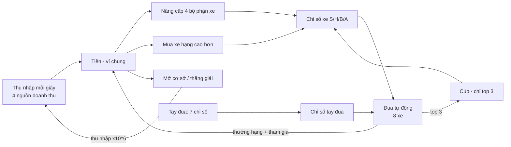

# Cơ chế nâng cấp và sức mạnh của racing_manager

- Ngày phân tích: 12/11/2026
- Phạm vi: đọc `Design/`, `data/*.json` và các hàm chính trong `game/game_state.gd`, `core/economy/pricing.gd`, `core/sim/traffic_sim.gd`.
- **Giới hạn:** chưa chạy game, chưa chạy test hay lab mô phỏng. Số liệu lấy từ cấu hình và mã nguồn tại thời điểm trên; nhiều giá trị trong tài liệu thiết kế được ghi là placeholder, cần cân bằng lại.

## 1. Tổng quan

Game đua **tự động**. Người chơi không điều khiển xe, chỉ quyết định phân bổ tiền giữa tăng thu nhập và tăng sức mạnh xe.



Nguyên tắc thiết kế (theo `Design/03_Release_Overview.md`): lựa chọn thay cho may rủi, thua vẫn tiến bộ, không năng lượng/vé đua.

## 2. Các hệ thống nâng cấp

### 2.1 Nâng cấp doanh thu (4 mục, tối đa 200 cấp)

Cấu hình: `data/economy.json` → `revenue_upgrades`. Tính toán: `Pricing.revenue_gain`, `Pricing.revenue_rate`.

| Mục | Giá trị gốc | Cộng mỗi cấp | Giá gốc | Tăng trưởng |
|---|---|---|---|---|
| Ticket Marketing | 8,0 /s | +0,25 | 150 | ×1,003 mỗi cấp |
| Victory Celebrations | 0 /s | +0,75 | 300 | ×1,003 mỗi cấp |
| Parking | 0 /s | +1,25 | 500 | ×1,003 mỗi cấp |
| Grandstands (sức chứa) | 10 | +0,5 | 800 | tuyến tính |

- Phần tăng thêm của một nguồn ở cấp `L`: `per_level × L × 1,003^L × 1,1^(số mốc sao)`.
- Mốc sao ở cấp **25 / 50 / 100 / 150**, mỗi mốc nhân thêm **×1,1**.
- Thu nhập mỗi giây = `(vé + ăn mừng + đỗ xe) × (sức chứa / 10) × scale(bậc)`.
- Thu nhập **chạy liên tục**, kể cả khi không đua và ở mọi cơ sở. Boost quảng cáo chỉ nhân thu nhập online và thưởng đua, không nhân offline.
- Nâng cấp doanh thu có hiệu lực **ngay**, kể cả đang đua.

### 2.2 Nâng cấp bộ phận xe (4 mục, tối đa 200 cấp)

| Bộ phận | Chỉ số | Cộng mỗi cấp | Giá gốc | Tác dụng trong đua |
|---|---|---|---|---|
| Động cơ | S (Speed) | +0,25 | 160 | Tốc độ trên đoạn thẳng |
| Lốp | H (Handling) | +0,15 | 80 | Tốc độ qua cua |
| Khung gầm | B (Stability) | +0,20 | 130 | Giảm xác suất mắc lỗi |
| Hộp số | A (Acceleration) | +0,18 | 110 | Tăng tốc khi ra cua và sau lỗi |

- Chỉ số bộ phận = **chỉ số nền của xe đang dùng + hệ số × cấp** (`GameState.part_stat`).
- Nâng bộ phận trong lúc đua **chỉ áp dụng từ lượt sau**. Mô phỏng lượt đang chạy dùng chỉ số đã chốt lúc xuất phát (`race_snapshot`).
- Hỗ trợ mua **×1 / ×10 / ×Max** (`plan_buy`, `buy_many`).

### 2.3 Công thức giá

```text
cost(m → m+1) = S(bậc) × ceil( base × pacing(bậc) × D × g^m / K )
g = upgrade_growth^(1/level_subdivision) = 1,572^(1/10) ≈ 1,046
K = Σ g^j (j = 0..9)
D = duration_factor = 3
```

- `S(bậc) = 10^(6 × bậc)`, `pacing` = 1, 2, 4, 8, 16, 32 theo bậc.
- `K` chuẩn hóa để tổng 10 cấp nhỏ bằng đúng một cấp cũ (thang 20 cấp trước đây).
- Tiền và giá dùng `BigNumber` tự viết (`core/math/big_number.gd`) vì vượt xa giới hạn số thực.
- Hệ số `D = 3` được chốt ngày 10/11/2026. Theo mô hình trong `Design/13_Upgrade_Ladder_200.md`: đủ 200 cấp ở bậc đầu khoảng 1,7 giờ, cả game khoảng 75 giờ online. Mô hình chỉ tính doanh thu, mua tức thời, một chiến lược, nên **không phải playtest**.

### 2.4 Xe (15 xe, 5 hạng)

Mỗi hạng có 3 biến thể: **Tia chớp** (thiên S), **Bám đường** (thiên H), **Bền bỉ** (thiên B và A).

| Hạng | Chỉ số nền S/H/B/A (Tia chớp) | Giá (khoảng) |
|---|---|---|
| 1 – Pico | 46 / 38 / 38 / 38 | 0 – 5.000 |
| 2 – Nova | 62 / 54 / 54 / 54 | 4,4 – 8,8 × 10¹² |
| 3 – Apex | 80 / 72 / 72 / 72 | ~10¹⁹ |
| 4 – Titan | 100 / 92 / 92 / 92 | ~10²⁵ |
| 5 – Zenith | 122 / 114 / 114 / 114 | ~10³¹ |

Nền xe chênh khoảng 16–22 điểm giữa các hạng.

### 2.4b Bậc kinh doanh, thăng giải và cơ sở

- 6 bậc (giải): Tập sự, Bán chuyên, Chuyên nghiệp, Quốc gia, Châu lục, Thế giới.
- Điều kiện thăng giải: **4 nguồn doanh thu ≥ cấp 120**, xe đủ hạng của giải kế, đủ phí mở = `rate tham chiếu × pacing × 300 giây`.
- Thăng giải **reset 4 nguồn doanh thu về 0**, thu nhập nhân 10⁶, cộng vốn khai trương.
- Cơ sở độc lập (doanh thu, giải, nâng cấp, garage riêng) nhưng **dùng chung một ví tiền** (`Design/26_Independent_Facilities.md`). Mới xong F0–F1.

### 2.5 Tay đua (12 người)

Bảy chỉ số (`data/drivers.json`, `Design/16_Driver_Stats_Styles_Stamina.md`):

| Chỉ số | Khóa | Tác dụng |
|---|---|---|
| Speed | `pace` (P) | Tốc độ đoạn thẳng |
| Cornering | `technique` (T) | Tốc độ cua |
| Composure | `composure` (C) | Giảm lỗi, giữ chế độ ga lâu hơn |
| Launch | `launch` (L) | Gia tốc xuất phát |
| Braking | `braking` (R) | Lực phanh, tốc độ vào cua |
| Racecraft | `racecraft` (K) | Nhân sức mạnh bonus phong cách (0,5–1,8×) |
| Endurance | `endurance` (E) | Giảm tốc độ hao stamina |

Bốn phong cách (`sim.json` → `styles`):

| Phong cách | Hiệu ứng chính |
|---|---|
| inside – Late-brake attacker | +1,2% khi có xe sát phía trước; gia tốc ×0,96, cua ×0,995 |
| sweeper – Momentum rider | Cua thoáng +1,2%, cua bị kẹp −0,6% |
| counter – Counterpuncher | Hút gió ×2, +0,4% khi có xe phía trước |
| defender – Tactical defender | +1,2% khi có xe sát phía sau; giữ chế độ ga ×1,3 |

Stamina (`sim.json` → `stamina`): bắt đầu 100. Hao `balanced` 0,9/s, `push` 1,8/s (nhân hệ số endurance), `conserve` hồi 0,5/s. Tốc độ: push ×1,012, conserve ×0,992. Dưới 20 stamina bị phạt tối đa −2%.

Nâng cấp tay đua: dùng **mảnh** từ gacha, tối đa 5 cấp, mỗi cấp **+1 vào mọi chỉ số** (`driver_level_bonus`, `stat_bonus_per_level = 1`).

### 2.6 Nâng cấp bằng cúp

Cấu hình: `data/trophy_upgrades.json`, tài liệu `Design/24_Trophy_Upgrades.md`.

- Cúp **chỉ nhận khi về top 3**: P1 = 3, P2 = 2, P3 = 1, nhân hệ số giải (1 → 6).
- **Trần tổng cúp đã kiếm: 100** (tích lũy, tính cả phần đã tiêu). Chưa có cơ chế nâng trần, chỉ có chỗ để cộng `trophy_cap_bonus`.
- Giá nâng từ cấp `l` lên `l+1` bằng `cost_by_level[l]` (thường là cấp + 1).
- Hiệu ứng là **số cụ thể** cộng thẳng vào S/H/B/A hoặc thu nhập (tính bằng giây thu nhập), không phải phần trăm.

| Nhóm | Nâng cấp | Hiệu ứng tối đa | Mở từ giải |
|---|---|---|---|
| Tấn công | Động cơ đua | Speed +12 | 0 |
| Tấn công | Xuất phát nhanh | Accel +12 | 0 |
| Tấn công | Đà vượt xe | Speed +6, Accel +6 | 2 |
| Phòng thủ | Bám cua | Handling +12 | 0 |
| Phòng thủ | Ổn định thân xe | Stability +12 | 0 |
| Phòng thủ | Khung gầm đua | Handling +6, Stability +6 | 2 |
| Thu nhập | Nhà tài trợ | +15 giây thu nhập mỗi chặng | 0 |
| Thu nhập | Khán đài đông | +300 giây thu nhập mỗi quà ngày | 1 |

Lưu ý: bảng `effect_by_level` của các mục 10 cấp có 11 phần tử (cấp 0–10) nhưng `cost_by_level` chỉ 10, đúng theo cách tính "giá lên cấp kế".

### 2.7 Phụ kiện (gear) và gacha

- Gacha tay đua (`driver_gacha.json`) và phụ kiện (`gear.json`), trả bằng coupon hoặc gem, mở ×1 hoặc ×10.
- Có **bảo đảm (pity)** cho tay đua: gói Pro chắc chắn có Elite sau 13 lượt, gói All-Star chắc chắn có Legend sau 10 lượt.
- Phụ kiện có độ hiếm rare / epic / legendary, tối đa 5 cấp bằng mảnh, mỗi cấp cho `attack` và `defense`.
- **Phát hiện quan trọng:** `GameState.gear_bonus()` chỉ được định nghĩa, tìm kiếm không thấy nơi nào gọi nó trong `game/`, `ui/`, `core/`. Chú thích trong mã ghi "Chưa nối vào mô phỏng đua". Hiện phụ kiện **chưa ảnh hưởng đến sức mạnh hay kết quả đua**.

## 3. Sức mạnh được tính và dùng như thế nào

### 3.1 Sức mạnh hiển thị

- `team_power()` = **tổng 11 chỉ số** (S, H, B, A của xe và P, T, C, L, R, K, E của tay đua), làm tròn 0,1. Luôn theo cấp hiện tại.
- `power()` = trung bình 11 chỉ số, làm tròn số nguyên. Khi đang đua thì dùng chỉ số đã chốt lúc xuất phát.
- Mỗi chỉ số người chơi = chỉ số nền + nâng cấp + bonus cúp (S/H/B/A) hoặc bonus level tay đua.

### 3.2 Chuẩn của từng giải

Mô phỏng tính theo **độ lệch so với chuẩn giải** (`car_base`, `driver_base` trong `data/leagues.json`). Giải cao hơn đòi chỉ số cao hơn mới giữ được vị trí.

| Giải | car_base | driver_base |
|---|---|---|
| Tập sự | 40 | 40 |
| Bán chuyên | 52 | 44 |
| Chuyên nghiệp | 68 | 50 |
| Quốc gia | 86 | 56 |
| Châu lục | 106 | 62 |
| Thế giới | 128 | 68 |

### 3.3 Công thức mô phỏng (`data/sim.json`, `TrafficSim`)

Với `dX` là chênh lệch chỉ số so với chuẩn giải:

```text
straight = 20 + 0,05 × dS + 0,04 × dP
corner   = min(straight, 18 + 0,045 × dH + 0,04 × dT)
accel    = max(1,5, 3,8 + 0,07 × dA)
p_error  = clamp(0,35 − 0,0075 × dB − 0,005 × dC, 0,01, 0,6)   # mỗi lần kiểm tra đủ điều kiện
tốc độ mục tiêu = (straight hoặc corner) × form × hiệu ứng gần xe × stamina × speed_scale
```

- `form` ngẫu nhiên 0,985–1,015 một lần mỗi xe mỗi lượt (có khuếch đại giãn đoàn).
- `speed_scale = 6` là hệ số hiển thị.
- Mô phỏng **xác định theo seed**, tick cố định 10 Hz. RNG chỉ dùng cho xếp hàng xuất phát, form và lỗi.

### 3.4 Độ lớn thực tế

- Mỗi cấp bộ phận chỉ +0,15 đến +0,25 chỉ số, tức khoảng 0,05% tốc độ thẳng. Theo `Design/13_Upgrade_Ladder_200.md`, cần khoảng 10–30 cấp mới thấy đổi hạng.
- Cấp 200 của một bộ phận tương đương khoảng +10% tốc độ, so với khoảng cách giữa các hạng xe là 16–22 điểm nền.
- Khán giả chỉ là lớp vẽ, **không ảnh hưởng kết quả** (`Design/27_Spectators.md`).

### 3.5 Thưởng đua

```text
thưởng hạng      = thu nhập/s × (thời lượng + 3s) × 0,25 × hệ số hạng
thưởng tham gia  = thu nhập/s × (thời lượng + 3s) × 0,10
hệ số hạng       = 1 / 0,9 / 0,8 / 0,7 / 0,6 / 0,5 / 0,45 / 0,4  (hạng 1 → 8)
```

- Tổng thưởng một lượt bằng khoảng **20% (hạng 8) đến 35% (hạng 1)** thu nhập tích lũy trong thời gian cuộc đua, cộng thêm vào thu nhập online vẫn chạy song song.
- Điểm mùa theo hạng: 10, 8, 6, 5, 4, 3, 2, 1.
- Thu nhập offline = `rate × thời gian × 0,5`, trần 7.200 giây (2 giờ).

## 4. Nhận xét

1. **Thu nhập quyết định tiến trình, đua chỉ cộng thưởng phụ.** Do thưởng đua chỉ khoảng 20–35% thu nhập cùng khoảng thời gian, nâng doanh thu thường có lợi hơn nâng xe, trừ khi cần xe để đủ điều kiện thăng giải.
2. **Phụ kiện chưa có tác dụng** đến đua. Mua gacha phụ kiện hiện chưa làm đội mạnh hơn. Đây là việc nên nối vào `player_stats()` hoặc loại bỏ khỏi cửa hàng cho đến khi xong.
3. **Trần cúp 100** khiến nhóm nâng cấp cúp dừng ở một mức cố định và chưa có cách nâng trần.
4. **Bonus tay đua cộng đều +1 mọi chỉ số mỗi cấp**, tối đa +5, không phân biệt vai trò và nhỏ so với chỉ số xe. Cân nhắc chỉ số riêng theo phong cách.
5. **Cân bằng chưa chốt:** `Design/03` ghi còn phải chạy lab cho cả 6 giải và đặc tính tay đua; `gear.json` và `driver_gacha.json` ghi rõ giá trị là placeholder.
6. **Hệ cơ sở độc lập chưa hoàn thiện:** thiếu offline theo từng cơ sở (F2), thẻ Thăng giải và HUD (F3), lab cân bằng (F4).
7. **Chỉ số bộ phận là số thực** (`float`) với bước 0,15–0,25, nên UI cần hiển thị 1 chữ số thập phân và gom hiệu ứng ×10/×Max để người chơi thấy khác biệt.

## 5. Tệp nguồn liên quan

| Nội dung | Tệp |
|---|---|
| Cấu hình kinh tế, giá, thưởng | `data/economy.json` |
| Công thức giá và doanh thu | `core/economy/pricing.gd` |
| Hằng số cân bằng, định dạng | `core/balance.gd` |
| Số lớn | `core/math/big_number.gd` |
| Chỉ số, nâng cấp, cúp, phụ kiện, tay đua | `game/game_state.gd` |
| Mô phỏng đua | `core/sim/traffic_sim.gd`, `data/sim.json` |
| Giải, xe, tay đua | `data/leagues.json`, `data/cars.json`, `data/drivers.json` |
| Gacha, phụ kiện | `data/driver_gacha.json`, `data/gear.json` |
| Nâng cấp bằng cúp | `data/trophy_upgrades.json` |
| Thiết kế | `Design/11`, `12`, `13_Upgrade_Ladder_200`, `16`, `19`, `24`, `26_Independent_Facilities` |
